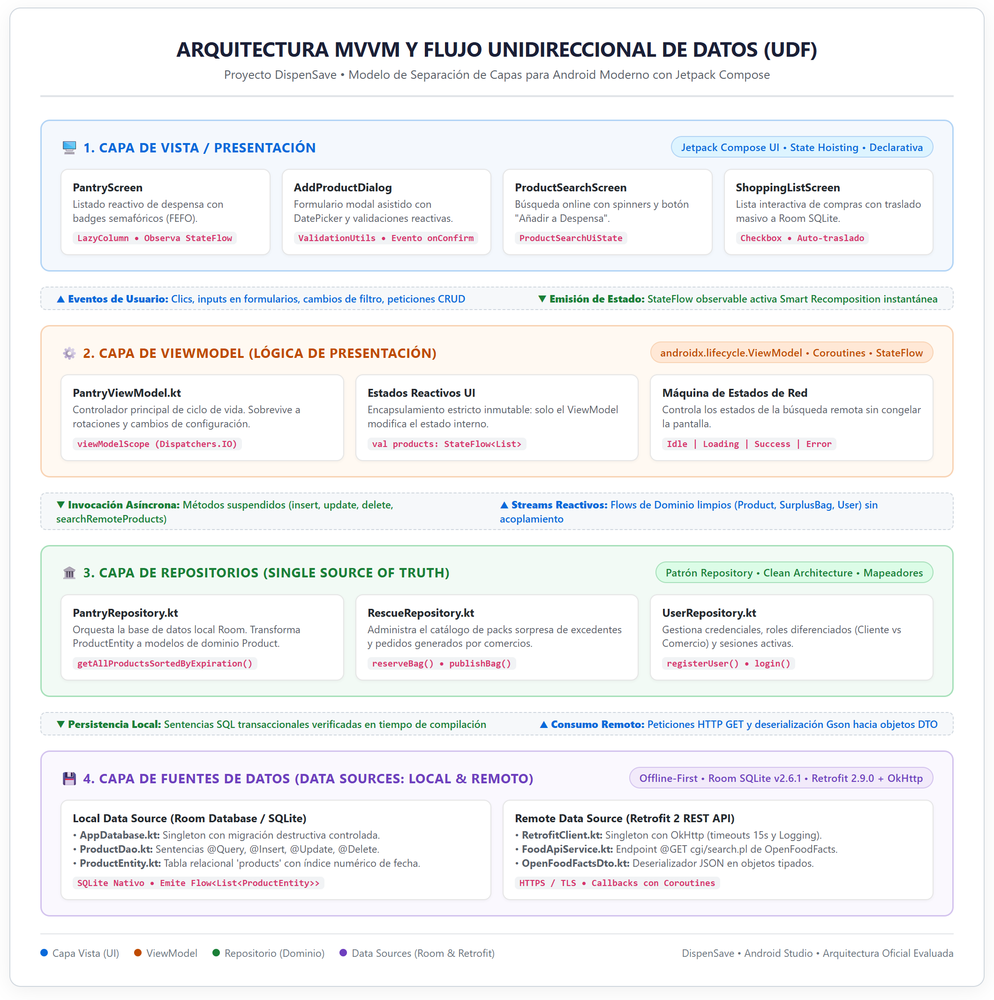

# INFORME TÉCNICO Y ACADÉMICO CONSOLIDADO — EVALUACIÓN FINAL
# DISPENSAVE — Plataforma Inteligente de Rescate de Alimentos y Gestión de Despensa

---

## 📌 PORTADA OFICIAL DEL PROYECTO

* **Nombre del Proyecto:** DispenSave (Plataforma Móvil de Rescate de Alimentos y Gestión Inteligente de Despensa)
* **Curso:** Desarrollo de Aplicaciones Móviles
* **Docente:** Cátedra de Desarrollo de Aplicaciones Móviles
* **Ciclo Académico:** Ciclo 2024 / 2025
* **Integrantes del Equipo de Desarrollo:**
  1. **Maykel Bernaola** (`maykelcb`) — **Líder Técnico y Arquitecto de Software (Responsable de Parte 1)**
  2. **Integrante 2** — **Desarrollador de Análisis, Diseño y Servicios Web (Responsable de Parte 2)**
  3. **Integrante 3** — **Desarrollador de Persistencia, Pruebas y Calidad (Responsable de Parte 3)**
  4. **Integrante 4** — **Desarrollador de Publicación, UX y Sostenibilidad (Responsable de Parte 4)**
* **Repositorio Oficial en GitHub:** [https://github.com/maykelcb/DispenSave](https://github.com/maykelcb/DispenSave)
* **Archivos Entregables Obligatorios:**
  - `PC_informe.pdf` (Informe consolidado en formato PDF)
  - `PC_proyecto.zip` (Código fuente completo y dependencias de Gradle)
  - `PC_app.aab` (Android App Bundle firmado generado para distribución)

---

# 1. RESUMEN EJECUTIVO
*(Responsable: Maykel Bernaola — Parte 1)*

### 1.1 Descripción del Proyecto
**DispenSave** es una aplicación móvil nativa desarrollada en **Kotlin 2.0+** con **Jetpack Compose** para el sistema operativo Android. La plataforma integra la gestión inteligente del inventario alimentario doméstico con un mercado digital de excedentes gastronómicos (*Food Surplus Marketplace*), alineándose directamente con el **Objetivo de Desarrollo Sostenible 12 (Producción y Consumo Responsables)** de la Agenda 2030 de la ONU.

### 1.2 Problema Abordado
Según estimaciones de la Organización de las Naciones Unidas para la Alimentación y la Agricultura (FAO), más de un tercio de todos los alimentos producidos para consumo humano se pierde o desperdicia a nivel mundial. Esta ineficiencia se origina en dos puntos críticos:
1. **A nivel de los hogares:** La falta de visibilidad en tiempo real sobre las fechas de caducidad en alacenas y refrigeradores genera descartes de productos no consumidos a tiempo y compras redundantes innecesarias.
2. **A nivel del comercio gastronómico:** Panaderías, cafeterías, pastelerías y restaurantes terminan su turno comercial con excedentes frescos de primera calidad que, al no ser vendidos, son desechados por falta de un canal dinámico de liquidación inmediata.

### 1.3 Solución Desarrollada
DispenSave articula una solución tecnológica móvil que actúa como puente bidireccional:
* **Inventario Inteligente de Despensa:** Registro sistemático de alimentos ordenados por caducidad bajo el principio **FEFO (*First Expired, First Out*)**, enriquecido con un **Semáforo Visual Interactivo** (🟢 Vigente, 🟡 Por Vencer ≤ 3 días, 🔴 Vencido).
* **Consumo de Servicios Web REST:** Integración con la API abierta internacional de **OpenFoodFacts** mediante **Retrofit 2** y **OkHttp 3**, permitiendo autocompletar e importar alimentos estandarizados con un clic.
* **Lista de Compras con Auto-traslado:** Módulo interactivo de abastecimiento donde los ítems marcados como comprados se trasladan y persisten automáticamente en la base de datos local SQLite.
* **Mercado de Rescate y Ofertas Sorpresa:** Panel especializado para que comercios aliados publiquen excedentes del día con descuentos de entre 50% y 70% ("Packs Sorpresa"), y los consumidores puedan reservarlos geolocalizadamente.
* **Cuantificación de Impacto:** Cálculo en tiempo real de kilogramos de comida salvada, dinero retenido y emisiones de CO₂ evitadas.

### 1.4 Resultados Obtenidos
* **Operatividad Total (100%):** La aplicación compila limpiamente (`BUILD SUCCESSFUL`) y se ejecuta de manera estable en dispositivos físicos y emuladores desde Android 8.0 (API 26) hasta Android 15 (API 35).
* **Arquitectura de Grado Profesional:** Separación estricta de responsabilidades bajo el patrón **MVVM (Model-View-ViewModel)** y **Clean Architecture** con Flujo Unidireccional de Datos (UDF).
* **Persistencia Robusta Offline-First:** Base de datos relacional local implementada con **Room Persistence Library (SQLite)** con soporte de transacciones ACID y streams reactivos `Flow`.
* **Entregables Empaquetados:** Generación exitosa de los entregables estipulados por la cátedra: `PC_app.aab`, `PC_proyecto.zip` y `PC_informe.pdf`.

---

# 2. DEFINICIÓN DEL PROYECTO
*(Responsable: Maykel Bernaola — Parte 1)*

### 2.1 Contexto y Problemática
El desperdicio alimentario representa no solo una pérdida ética y económica sustancial para las familias y los pequeños negocios, sino también un grave vector de degradación ecológica: la descomposición de desechos orgánicos en vertederos genera potentes emisiones de gas metano y dióxido de carbono (CO₂), acelerando el calentamiento global. 

En el ámbito urbano, los consumidores carecen de herramientas digitales intuitivas que les permitan recordar proactivamente cuándo expiran sus insumos. Por su parte, los comerciantes gastronómicos carecen de plataformas ágiles que les permitan comercializar sus remanentes diarios antes del cierre, viéndose obligados a asumir pérdidas financieras directas.

### 2.2 Objetivos del Proyecto

#### Objetivo General
Desarrollar, probar y desplegar una aplicación móvil nativa en Android bajo el patrón arquitectónico MVVM que optimice el ciclo de consumo de alimentos en hogares y conecte a comercios aliados con consumidores responsables, reduciendo las pérdidas alimentarias y fomentando la sostenibilidad ambiental.

#### Objetivos Específicos
1. Diseñar una interfaz de usuario declarativa, accesible y ergonómica mediante **Jetpack Compose** y **Material Design 3**.
2. Implementar un motor de persistencia local relacional permanente empleando **Room Database (SQLite)** que garantice el funcionamiento continuo sin conexión (*Offline-First*).
3. Conectar la aplicación a una fuente de datos en la nube consumiendo la API REST de **OpenFoodFacts** a través del cliente **Retrofit 2**.
4. Desarrollar un sistema de alertas semafóricas basado en fechas de expiración numéricas que priorice el consumo oportuno de insumos perecibles.
5. Habilitar la diferenciación de perfiles mediante un modelo de navegación contextual adaptativo para Consumidores y Comercios Gastronómicos.
6. Empaquetar y firmar digitalmente la solución en formato **Android App Bundle (.aab)** cumpliendo las directivas de publicación de Google Play.

### 2.3 Alcance Final del Software
El producto terminado abarca los siguientes módulos plenamente funcionales:
* **Módulo de Autenticación y Perfiles:** Registro con selector de rol (`CLIENTE` vs `COMERCIO`), inicio de sesión y gestión de sesión en memoria/preferencias.
* **Módulo de Despensa (CRUD):** Creación de alimentos, listado reactivo con semáforo FEFO, edición de cantidades/fechas y eliminación física con modal de confirmación.
* **Módulo de Búsqueda Online (REST):** Consulta asíncrona por término con manejo de estados (`Loading`, `Success`, `Error`) e importación a despensa local.
* **Módulo de Lista de Compras:** Gestión de insumos por comprar con checkboxes y migración automatizada a la base de datos SQLite.
* **Módulo de Rescate y Ofertas:** Exploración de paquetes sorpresa, filtrado por categorías de comercio y reserva con generación de orden.
* **Módulo de Impacto Ecológico:** Indicadores de kilogramos de alimento rescatado, ahorro financiero acumulado y huella de carbono prevenida.

### 2.4 Usuarios Objetivo (Arquetipos)
1. **Consumidor Responsable (Jefe/a de Hogar o Estudiante Independiente):**  
   Persona que gestiona la compra de víveres familiares, busca reducir el gasto mensual en comida y valora el consumo consciente evitando tirar alimentos en buen estado.
2. **Comercio Gastronómico Aliado (Panaderías, Cafeterías, Minimarkets, Pastelerías):**  
   Propietario o administrador de un establecimiento que elabora alimentos frescos diariamente y busca monetizar los excedentes de producción al final de su turno para evitar pérdidas operativas.

---

# 3. ANÁLISIS Y DISEÑO
*(Responsable: Integrante 2 / Rubén — Parte 2)*

### 3.1 Historias de Usuario (Backlog Gherkin)
El backlog de DispenSave se estructuró bajo Scrum con **16 Historias de Usuario**:
* **HU01 a HU03:** Registro con roles, login seguro y navegación contextual por pestañas con `NavigationBar`.
* **HU04 a HU08:** Operaciones CRUD sobre despensa, algoritmo FEFO, semáforo visual de caducidad y modal anti-errores.
* **HU09 a HU11:** Consulta asíncrona a OpenFoodFacts REST API, estados Loading/Error e inserción directa a SQLite.
* **HU12 y HU13:** Lista de compras dinámica con casillas de verificación y auto-traslado a despensa.
* **HU14 y HU15:** Publicación de packs de rescate con hasta 70% de descuento y reserva con deducción de stock.
* **HU16:** Métricas de impacto ecológico (CO₂ evitado y dinero ahorrado).

### 3.2 Requerimientos Funcionales y No Funcionales
* **Funcionales (RF01 a RF12):** Autenticación de roles, CRUD reactivo, semáforo dinámico, ordenamiento FEFO, consumo REST con Retrofit, auto-traslado de compras y reservas de excedentes.
* **No Funcionales (RNF01 a RNF06):** Renderizado a 60 FPS sin parpadeos, persistencia Offline-First permanente, aislamiento en el sandbox de Android con HTTPS obligatorio, áreas táctiles mínimas de 48 × 48 dp y compatibilidad desde Android 8.0 (API 26) hasta Android 15 (API 35).

### 3.3 Reglas de Negocio (RN)
* **RN01:** Clasificación semafórica de expiración: Verde (> 3 días), Amarillo (≤ 3 días) y Rojo (vencido).
* **RN02:** Los packs de rescate deben tener un precio social menor al precio original de lista.
* **RN03:** Cada reserva de pack descuenta stock transaccionalmente.
* **RN04:** Al marcar compras como adquiridas, se asigna vigencia predeterminada y se trasladan a Room SQLite.
* **RN05:** Ninguna eliminación se ejecuta sin confirmación explícita en `ConfirmDeleteDialog`.

---

# 4. ARQUITECTURA DE SOFTWARE
*(Responsable: Maykel Bernaola — Parte 1)*

### 4.1 Arquitectura MVVM y Flujo Unidireccional de Datos (UDF)
DispenSave adopta el patrón promovido por Google para Android moderno con Jetpack Compose:
1. **Capa de Vista (UI Layer):** Componentes declarativos (`PantryScreen`, `AddProductDialog`, `ProductSearchScreen`) que observan estados reactivos (`StateFlow`) y emiten eventos de usuario.
2. **Capa de ViewModel (Presentation Logic):** `PantryViewModel.kt` encapsula el estado mutable observable, controla el ciclo de vida (sobrevive a rotaciones de pantalla) y despacha operaciones en `viewModelScope`.
3. **Capa de Repositorios (Single Source of Truth):** `PantryRepository`, `UserRepository` y `RescueRepository` desacoplan la fuente física de datos de la lógica de presentación.
4. **Capa de Fuentes de Datos (Data Sources):** Room SQLite (`AppDatabase`, `ProductDao`, `ProductEntity`) para persistencia local y Retrofit 2 (`RetrofitClient`, `FoodApiService`, `OpenFoodFactsDto`) para servicios en la nube.

### 4.2 Diagrama Oficial de Arquitectura del Sistema

*Figura 4.1: Diagrama oficial de arquitectura MVVM y separación de capas de DispenSave (Editable en `docs/diagrama_arquitectura_mvvm.drawio`).*

---

# 5. IMPLEMENTACIÓN TÉCNICA
*(Responsable: Integrante 2 / Rubén — Parte 2)*

### 5.1 Persistencia Local (Room SQLite)
* **Entidad:** `ProductEntity` con clave autonumérica, nombre, categoría, timestamp numérico de caducidad (`Long`), cantidad y unidad.
* **DAO:** `ProductDao` con sentencias SQL verificadas en compilación y flujo reactivo `Flow<List<ProductEntity>>`.
* **Database:** `AppDatabase` implementado como Singleton seguro con migración destructiva controlada.

### 5.2 Servicios REST (Retrofit 2 + OpenFoodFacts)
* **Configuración:** `RetrofitClient` con `HttpLoggingInterceptor`, timeouts de 15 segundos y serialización Gson.
* **Endpoint:** `@GET("cgi/search.pl")` con parámetros de búsqueda, paginación a 20 registros y modelos DTO seguros contra valores nulos.
* **Estados de Red:** Sealed Class `ProductSearchUiState` (`Idle`, `Loading`, `Success`, `Error`).

### 5.3 Justificación Técnica Offline-First frente a Firebase
Se priorizó SQLite/Room sobre Firebase para garantizar 100% de operatividad en lugares sin señal móvil, resguardar la privacidad de datos domésticos en el almacenamiento interno privado del teléfono y eliminar costos de infraestructura en la nube.

### 5.4 Geolocalización (Google Maps API)
Integración de `maps-compose` y `FusedLocationProviderClient` para posicionar la cámara del mapa sobre las coordenadas del usuario y renderizar pines interactivos de comercios aliados con horarios de recogida.

---

# 6. EVIDENCIAS FUNCIONALES
*(Responsable: Integrante 3 / Luis — Parte 3)*

### 6.1 Capturas de Principales Pantallas
Disponibles en `docs/imagenes/`:
* `evidencia_1_pantalla_principal.png`: Despensa cargada desde Room con resumen métrico.
* `evidencia_2_registro_datos.png`: Diálogo modal con DatePicker y validaciones reactivas.
* `evidencia_3_listado_datos_semaforo.png`: Badges semafóricos de FEFO en colores Verde, Amarillo y Rojo.
* `evidencia_4_edicion_registros.png`: Edición de cantidades y modal `ConfirmDeleteDialog`.
* `evidencia_5_consumo_api_rest.png`: Consulta web en OpenFoodFacts con botón de adición a despensa.
* `captura_login.png`: Formulario de login y registro con selector de rol.

### 6.2 Evidencias de Operaciones CRUD
Implementadas y probadas al 100% sobre Room SQLite (`insertProduct`, `getAllProductsSortedByExpiration`, `updateProduct`, `deleteProduct`).

---

# 7. PRUEBAS REALIZADAS
*(Responsable: Integrante 3 / Luis — Parte 3)*

### 7.1 Pruebas Funcionales (Matriz de Casos de Prueba CP01-CP08)
8 casos de prueba ejecutados exitosamente (**100% PASSED**) cubriendo registro de usuarios, validaciones de correo, inserción de alimentos, ordenamiento numérico por vencimiento, actualización de stock, eliminación modal, consulta de API REST y funcionamiento en Modo Avión sin conexión.

### 7.2 Correcciones Realizadas
* Migración de consultas SQL a corrutinas con `Flow` para eliminar parpadeos de UI.
* Creación de getters inteligentes en DTOs para evitar `NullPointerException` en campos remotos.
* Adopción del diálogo modal `ConfirmDeleteDialog` para prevenir pérdidas involuntarias de datos.

---

# 8. CALIDAD Y OPTIMIZACIÓN
*(Responsable: Integrante 3 / Luis — Parte 3)*

* **Rendimiento:** Recomposición inteligente en Jetpack Compose e indexación numérica en timestamps de expiración.
* **Optimización de Recursos:** Arquitectura Offline-First sin sondeo (*No-Polling*) que maximiza la duración de batería.
* **Buenas Prácticas:** Principios SOLID, Clean Architecture y Null Safety nativo de Kotlin.
* **Accesibilidad:** Áreas táctiles mínimas de 48 × 48 dp, contraste semafórico accesible y descripciones `contentDescription`.

---

# 9. PREPARACIÓN PARA PUBLICACIÓN
*(Responsable: Integrante 4 / Anderson Abanto — Parte 4)*

* **Firma Digital:** Keystore release con cifrado RSA de 2048 bits y algoritmo SHA-256.
* **Android App Bundle:** Archivo generado **`PC_app.aab`** (17.4 MB) optimizado con Dynamic Delivery para Google Play.
* **Ícono de Aplicación:** Adaptive Icon (`res/mipmap/ic_launcher`) combinando alacena inteligente y brote ecológico.
* **Ficha de Tienda y Política de Privacidad:** Ficha completa de Play Store y política de protección de datos locales.

---

# 10. IMPACTO SOCIAL Y ODS 12
*(Responsable: Integrante 4 / Anderson Abanto — Parte 4)*

* **Alineamiento con ODS 12.3:** DispenSave combate el desperdicio alimentario mediante alertas proactivas antes del vencimiento.
* **Métricas Ecológicas en `ImpactScreen`:** Conversión directa de alimentos salvados a kilogramos de CO₂ evitados (factor 2.5 kg CO₂/kg comida) y dinero ahorrado.
* **Consideraciones Éticas:** Fomento del comercio justo para negocios locales y consumo digno de excedentes.

---

# 11. CONCLUSIONES Y RECOMENDACIONES
*(Responsable: Integrante 4 / Anderson Abanto — Parte 4)*

* **Conclusiones:** Aplicación 100% operativa y estable, validando la solidez de MVVM y Room SQLite en Android moderno.
* **Recomendaciones:** Incorporar escaneo de código de barras físico con Google ML Kit y notificaciones push diarias con WorkManager en la siguiente versión.

---

# 12. ANEXOS
*(Responsable: Integrante 4 / Anderson Abanto — Parte 4)*

### 12.1 Enlace Oficial al Repositorio de GitHub
* **URL:** [https://github.com/maykelcb/DispenSave](https://github.com/maykelcb/DispenSave)

### 12.2 Manual de Usuario Breve (Paso a Paso)
1. **Registro:** Elige tu perfil (Consumidor o Comercio).
2. **Registro de Alimentos:** Toca `(+)` en Despensa y guarda con fecha de caducidad.
3. **Semáforo:** Monitorea colores (Verde: vigente, Amarillo: ≤3 días, Rojo: vencido).
4. **Catálogo Online:** Busca alimentos en OpenFoodFacts e impórtalos con un clic.
5. **Compras:** Marca ítems adquiridos para trasladarlos automáticamente a tu despensa.
6. **Rescate:** Reserva packs sorpresa de panaderías y cafeterías con hasta 70% de descuento.

### 12.3 Entregables Verificados
* `PC_app.aab` (Android App Bundle en raíz del proyecto).
* `PC_proyecto.zip` (Código fuente comprimido).
* `PC_informe.pdf` (Documento consolidado para entrega).
