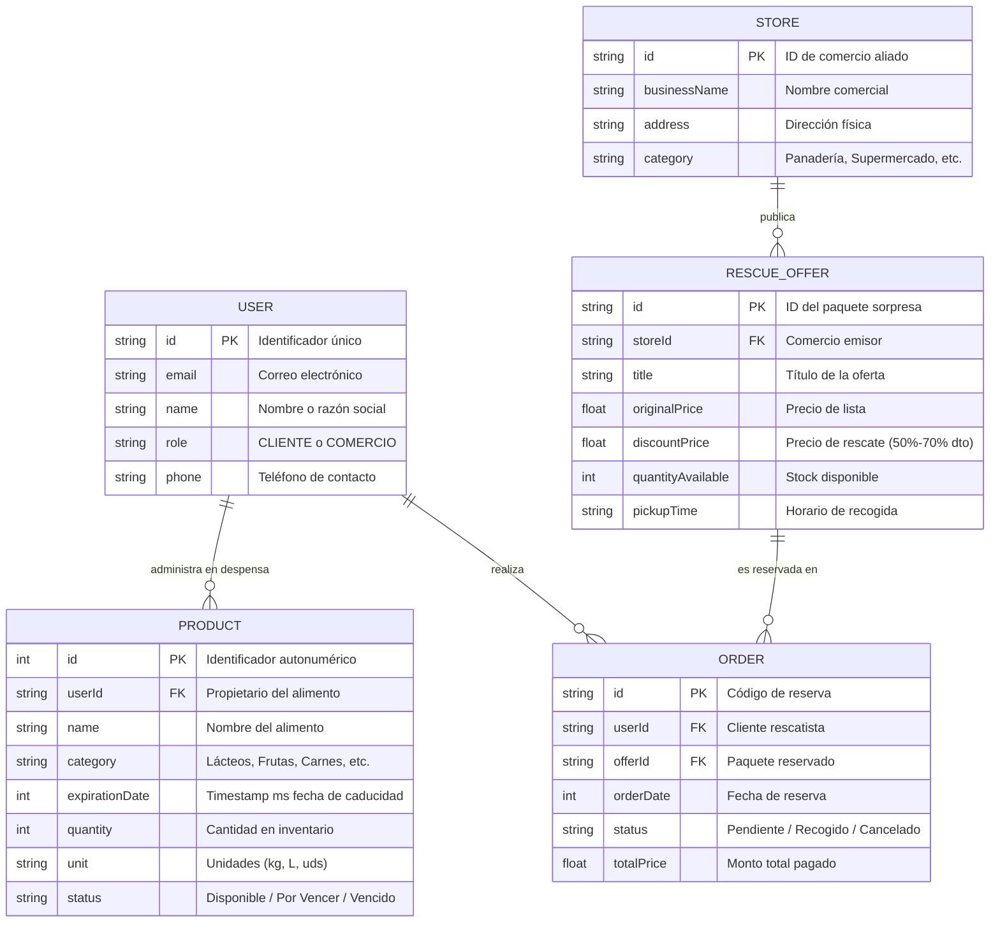

# INFORME FINAL DE PROYECTO DE DESARROLLO DE SOFTWARE
# DISPENSAVE — Plataforma Inteligente de Rescate de Alimentos y Gestión de Despensa

---

**Asignatura:** Desarrollo de Aplicaciones Móviles  
**Proyecto:** DispenSave  
**Repositorio Oficial en GitHub:** [https://github.com/maykelcb/DispenSave](https://github.com/maykelcb/DispenSave)  
**Fecha de Entrega:** Ciclo Académico 2024 / 2025  

### Equipo de Desarrollo y Distribución Colaborativa

| N° | Integrante | Rol en el Proyecto | Rama de Trabajo en GitHub | Pull Request Asociado | Módulos y Secciones Responsables |
|:---:|:---|:---|:---:|:---:|:---|
| 1 | **Maykel Bernaola** (`maykelcb`) | Líder Técnico y Arquitecto de Software | `main` | Integrador Principal | Arquitectura MVVM, Navegación Central, Catálogo de Rescate, Sprint 1 (HU01-HU04) |
| 2 | **Luis Caccha** (`LuisCaccha12`) | Desarrollador de Servicios y Conectividad REST | `feature/retrofit-api-consumption` | PR #2 (Mergeado) | Cliente Retrofit 2, API OpenFoodFacts, DTOs, Búsqueda Online, Sprint 2 (HU05-HU08) |
| 3 | **Rubén** (`ruben.dispensave@gmail.com`) | Desarrollador Backend Local y Persistencia | `feature/room-crud-pantry` | PR #3 (Mergeado) | Persistencia Room SQLite, ProductDao, Repositorio Reactivo, CRUD, Sprint 3 (HU09-HU12) |
| 4 | **Anderson Abanto (Andy)** (`andyabantomendoza`) | Desarrollador UI/UX y Experiencia de Usuario | `feature/shopping-list-alerts` | PR #1 (Mergeado) | Lista de Compras, Alertas Semafóricas, Heurísticas Nielsen, Sprint 4 (HU13-HU16) |

---

# IV. DISEÑO DE LA SOLUCIÓN

## 4.1 Arquitectura de la Aplicación

### 4.1.1 Arquitectura Seleccionada: MVVM (Model-View-ViewModel) + Principios de Clean Architecture

Para el desarrollo de la aplicación **DispenSave**, se seleccionó el patrón arquitectónico **MVVM (Model-View-ViewModel)** complementado con principios de **Clean Architecture**, siguiendo los estándares oficiales promovidos por Google para el desarrollo moderno en Android con **Jetpack Compose**.

MVVM desacopla de manera estricta la interfaz gráfica de usuario de la lógica de presentación y de las fuentes de datos. Se estructura en tres capas principales con un **Flujo Unidireccional de Datos (UDF - Unidirectional Data Flow)**:

1. **Capa de Presentación (UI Layer / View):**
   - Construida íntegramente con **Jetpack Compose**, el kit moderno de interfaz declarativa de Android.
   - Es totalmente reactiva y sin estado propio persistente (*Stateless* en componentes hijos mediante *State Hoisting*).
   - Observa flujos de estado (`StateFlow` y `State`) expuestos por el ViewModel y emite eventos de usuario hacia este.
   - Principales pantallas: `PantryScreen`, `ProductSearchScreen`, `ShoppingListScreen`, `ProductDetailScreen`, `ExploreScreen`, `StoreDashboardScreen`, `LoginScreen`, `RegisterScreen`, `ImpactScreen`.

2. **Capa de ViewModel (Presentation Logic):**
   - Encabezada por `PantryViewModel`, hereda de `androidx.lifecycle.ViewModel`.
   - Sobrevive a los cambios de configuración del dispositivo (como rotaciones de pantalla o cambios de tema).
   - Transforma los datos de los repositorios en estados listos para el consumo de la interfaz mediante `StateFlow` y `mutableStateOf`.
   - Ejecuta operaciones asíncronas no bloqueantes a través de corrutinas en el ámbito `viewModelScope`.

3. **Capa de Dominio (Domain Layer):**
   - Modela las entidades del negocio y reglas independientes del framework: `Product`, `ProductStatus`, `RescueOffer`, `User`, `UserRole`.
   - Contiene la lógica del semáforo de caducidad (`calculatedStatus`, `daysUntilExpiration`, `isExpired`).

4. **Capa de Datos (Data Layer / Repositories & Data Sources):**
   - Implementa el patrón **Repository** (`PantryRepository`, `UserRepository`, `RescueRepository`), el cual actúa como fuente única de verdad (*Single Source of Truth*).
   - **Fuente de Datos Local:** Base de datos relacional SQLite gestionada mediante **Room Persistence Library** (`AppDatabase`, `ProductDao`, `ProductEntity`). Emite streams reactivos (`kotlinx.coroutines.flow.Flow`).
   - **Fuente de Datos Remota:** Servicio web REST mediante **Retrofit 2** y **OkHttp** (`RetrofitClient`, `FoodApiService`, `OpenFoodFactsDto`), consumiendo la API abierta internacional de OpenFoodFacts.

---

### 4.1.2 Diagrama de Arquitectura de la Solución

```
┌─────────────────────────────────────────────────────────────────────────────┐
│                            CAPA DE PRESENTACIÓN                             │
│                     (Jetpack Compose UI Declarativa)                        │
│                                                                             │
│  ┌──────────────────┐  ┌──────────────────┐  ┌───────────────────────────┐  │
│  │   PantryScreen   │  │ShoppingListScreen│  │    ProductSearchScreen    │  │
│  │ (Despensa CRUD)  │  │(Lista de Compras)│  │    (Consumo API REST)     │  │
│  └────────┬─────────┘  └────────┬─────────┘  └─────────────┬─────────────┘  │
│           │                     │                          │                │
│  ┌────────┴─────────┐  ┌────────┴─────────┐  ┌─────────────┴─────────────┐  │
│  │ProductDetailScr. │  │  ExploreScreen   │  │ Login / Register / Impact │  │
│  └────────┬─────────┘  └────────┬─────────┘  └─────────────┬─────────────┘  │
└───────────┼─────────────────────┼──────────────────────────┼────────────────┘
            │ Eventos de Usuario  │ Observa Estado UI        │
            ▼ (Clicks, Inputs)    ▲ (StateFlow / Flow)       │
┌─────────────────────────────────┴──────────────────────────┴────────────────┐
│                             CAPA DE VIEWMODEL                               │
│                         (PantryViewModel.kt)                                │
│                                                                             │
│  - allProducts: StateFlow<List<Product>>   - shoppingList: List<ShoppingItem>│
│  - apiSearchResults: StateFlow<List<...>>  - isSearching / errorMessage     │
│  - CoroutineScope (viewModelScope) con Dispatchers.IO / Dispatchers.Main     │
└─────────────────────────────────┬───────────────────────────────────────────┘
                                  │ Invoca operaciones suspendidas
                                  ▼ Retorna DTOs / Flows de Dominio
┌─────────────────────────────────────────────────────────────────────────────┐
│                           CAPA DE DATOS (REPOSITORIOS)                      │
│                  (Fuente Única de Verdad - Single Source)                   │
│                                                                             │
│  ┌──────────────────────────┐                  ┌─────────────────────────┐  │
│  │     PantryRepository     │                  │     RescueRepository    │  │
│  │   (Persistencia Local)   │                  │   UserRepository (Prefs)│  │
│  └─────────────┬────────────┘                  └─────────────────────────┘  │
└────────────────┼─────────────────────────────────────────────┬──────────────┘
                 │                                             │
      ┌──────────┴──────────┐                       ┌──────────┴──────────┐
      ▼                     ▼                       ▼                     ▼
┌───────────────────────────────────┐   ┌─────────────────────────────────────┐
│       FUENTE DE DATOS LOCAL       │   │       FUENTE DE DATOS REMOTA        │
│          (SQLite / Room)          │   │      (API REST OpenFoodFacts)       │
│                                   │   │                                     │
│  - AppDatabase (RoomDatabase)     │   │  - RetrofitClient (OkHttpClient)    │
│  - ProductDao (@Dao)              │   │  - FoodApiService (@GET search.pl)  │
│  - ProductEntity (@Entity)        │   │  - OpenFoodFactsDto (JSON Deserial) │
│  - CRUD Offline-First Permanente  │   │  - Catálogo Internacional Alimentos │
└───────────────────────────────────┘   └─────────────────────────────────────┘
```

---

### 4.1.3 Flujo General de Información (Unidirectional Data Flow - UDF)

El flujo de información dentro de DispenSave se divide en dos circuitos principales:

#### Circuito 1: Persistencia Local Reactiva (Despensa y Lista de Compras)
1. El usuario interactúa con la pantalla `PantryScreen` (por ejemplo, presiona "Guardar" en `AddProductDialog` o cambia la cantidad en `ProductDetailScreen`).
2. La vista delega la acción al `PantryViewModel` mediante métodos públicos (`addProduct`, `updateProduct`, `deleteProduct`).
3. El ViewModel lanza una corrutina en `viewModelScope` e invoca al `PantryRepository`.
4. El repositorio transforma el modelo de dominio (`Product`) a la entidad de base de datos (`ProductEntity`) y la envía al `ProductDao`.
5. Room ejecuta la sentencia SQL en la base de datos SQLite local dentro de una transacción segura.
6. Gracias a que el DAO retorna un `Flow<List<ProductEntity>>`, Room notifica automáticamente el cambio en la tabla `products`.
7. El repositorio mapea la nueva lista a modelos `Product` y la emite al ViewModel.
8. El ViewModel actualiza el `StateFlow` y Jetpack Compose recompone instantáneamente las pantallas vinculadas sin necesidad de recargar la vista manualmente.

#### Circuito 2: Consumo Asíncrono de API REST Externa
1. En `ProductSearchScreen`, el usuario escribe el nombre de un alimento (ejemplo: "Arroz", "Leche", "Yogurt").
2. El ViewModel establece el estado reactivo `isSearching = true` y limpia mensajes de error previos.
3. La interfaz gráfica reacciona mostrando un indicador de progreso (`CircularProgressIndicator`).
4. En un hilo de fondo (`Dispatchers.IO`), el ViewModel invoca a `RetrofitClient.apiService.searchProducts(query)`.
5. OkHttp envía la petición HTTP GET hacia `https://world.openfoodfacts.org/cgi/search.pl`.
6. Si la respuesta es exitosa (HTTP 200), Gson deserializa el JSON en `OpenFoodFactsResponseDto` y el ViewModel actualiza `apiSearchResults` con los productos mapeados.
7. Si ocurre una excepción (sin conexión, timeout o error 5xx), se captura en un bloque `try-catch`, actualizando `errorMessage` para que la UI muestre un estado amigable con botón de reintento.
8. Cuando el usuario selecciona "Añadir a Despensa" sobre un resultado de la API, este se convierte directamente en un `Product` y se persiste en SQLite a través del Circuito 1.

---

### 4.1.4 Justificación Técnica de la Arquitectura Elegida

| Criterio | MVVM (Elegida para DispenSave) | MVC (Model-View-Controller) | MVP (Model-View-Presenter) | Clean Architecture Pura |
|:---|:---|:---|:---|:---|
| **Acoplamiento con UI** | **Bajo.** La vista observa estados; el ViewModel no conoce la UI. | Alto. El Controlador manipula directamente la vista. | Medio. El Presentador requiere una interfaz estricta con la Vista. | Mínimo, pero genera sobrecarga de capas (*Overengineering*). |
| **Compatibilidad con Jetpack Compose** | **Nativa.** El modelo declarativo de Compose se basa en recomposición por estado reactivo. | Muy pobre. Pensado para ciclos de vida imperativos y vistas XML. | Deficiente. Requiere bridges e interfaces de callback complejas. | Alta, pero requiere mapeadores intermedios redundantes para proyectos ágiles. |
| **Persistencia del Estado** | **Excelente.** El ViewModel sobrevive a rotaciones de pantalla y recreación de Activity. | Nula. El controlador se destruye con el ciclo de vida del Activity. | Nula. El Presenter se destruye a menos que se use retención manual. | Alta si se combina con ViewModel en la capa de presentación. |
| **Testabilidad** | **Alta.** Se pueden realizar pruebas unitarias en ViewModel sin emuladores de Android. | Difícil debido al acoplamiento con clases del SDK de Android. | Alta, pero exige una gran cantidad de mocks de interfaces. | Máxima testabilidad por aislamiento absoluto. |

**Conclusión:** MVVM es la arquitectura idónea para DispenSave porque maximiza la reactividad de Jetpack Compose, garantiza la separación estricta de responsabilidades, soporta el ciclo de vida de Android sin fugas de memoria y proporciona una base sólida y mantenible.

---

## 4.2 Tecnologías Utilizadas

Para garantizar un producto robusto, escalable y con excelente desempeño en dispositivos móviles Android, se seleccionaron cuidadosamente las siguientes herramientas y librerías técnicas:

```
┌─────────────────────────────────────────────────────────────────────────────┐
│                          STACK TECNOLÓGICO DISPENSAVE                       │
├──────────────────────┬──────────────────────────────────────────────────────┤
│ Lenguaje             │ Kotlin 2.0+ (Google First-Class Language for Android)│
│ Framework UI         │ Android SDK (Min API 26, Target API 35) + Compose    │
│ Base de Datos Local  │ Room Persistence Library 2.6.1 sobre SQLite nativo   │
│ Cliente Red / HTTP   │ Retrofit 2.9.0 + OkHttp 4.12.0 + HttpLoggingInterceptor│
│ Serialización JSON   │ Google Gson Converter 2.9.0                          │
│ Concurrencia         │ Kotlin Coroutines 1.8.0 + StateFlow / Flow           │
│ Navegación           │ Jetpack Compose Navigation 2.8.5                     │
│ Sistema de Diseño    │ Material Design 3 (Material3 1.3.1)                  │
│ Control de Versiones │ Git + GitHub (Ramas Git Flow + Pull Requests)        │
└──────────────────────┴──────────────────────────────────────────────────────┘
```

### Justificación Técnica de Cada Elección

1. **Lenguaje de Programación: Kotlin 2.0+**
   - *Seguridad contra Nulos (Null-Safety):* Elimina la principal causa de fallos en Android (`NullPointerException`) en tiempo de compilación.
   - *Extension Functions y Data Classes:* Permite escribir código conciso, legible y expresivo para modelos y mapeadores de entidades.
   - *Corrutinas y Soporte Asíncrono de Primera Clase:* Facilita la programación asíncrona no bloqueante sin lidiar con *callback hell*.

2. **Framework de Desarrollo: Android SDK + Jetpack Compose**
   - Sustituye el antiguo sistema imperativo basado en archivos XML por una sintaxis 100% Kotlin declarativa.
   - Reduce las líneas de código de interfaz de usuario en más de un 40% y elimina los errores de sincronización entre el estado y la vista.
   - Proporciona previsualizaciones en tiempo real en Android Studio y optimiza el árbol de renderizado a través de *Smart Recomposition*.

3. **Base de Datos Local: Room Persistence Library (v2.6.1)**
   - Actúa como una capa de abstracción fluida sobre el motor relacional SQLite nativo de Android.
   - Valida las consultas SQL (`@Query`) en tiempo de compilación, impidiendo errores de sintaxis en tiempo de ejecución.
   - Soporte nativo para corrutinas (`suspend fun`) y streams reactivos (`Flow<List<T>>`), permitiendo que cualquier cambio en la base de datos actualice la UI automáticamente.

4. **Servicio API Externo: OpenFoodFacts REST API (v0/v2)**
   - Servicio web libre y colaborativo con más de 3 millones de productos alimenticios catalogados a nivel mundial.
   - Proporciona información nutricional, marcas, categorías y nombres estandarizados mediante un endpoint HTTP REST accesible vía JSON.
   - Permite a los usuarios de DispenSave registrar alimentos escaneados o buscados sin necesidad de rellenar manualmente todos los campos.

5. **Librerías de Red: Retrofit 2 (v2.9.0) y OkHttp 3 (v4.12.0)**
   - **Retrofit 2:** Convierte interfaces de Kotlin en llamadas HTTP de tipo seguro de manera declarativa.
   - **OkHttp 3:** Maneja la capa de transporte con soporte para HTTP/2, *connection pooling*, compresión transparente y tiempos de espera configurables (*timeouts* de 15s para lectura y conexión).
   - **HttpLoggingInterceptor:** Permite registrar los encabezados y cuerpos de las peticiones/respuestas durante el desarrollo para verificar la comunicación en el Logcat.

6. **Librería de Navegación: AndroidX Navigation Compose (v2.8.5)**
   - Gestiona el *backstack* nativo del sistema Android, permitiendo transiciones fluidas entre pantallas.
   - Enrutamiento tipado y modularizado que soporta parámetros y navegación anidada para menús inferiores (`NavigationBar`).

---

## 4.3 Diseño de Base de Datos

### 4.3.1 Modelo Entidad-Relación (MER)

DispenSave utiliza una base de datos local SQLite bajo el modelo **Offline-First**. El núcleo de la persistencia local es la entidad `products`, complementada por las entidades de negocio de comercio, reservas y usuarios.



---

### 4.3.2 Diccionario de Datos

A continuación se detalla la estructura física de la tabla principal persistida en el dispositivo mediante SQLite/Room:

#### Tabla: `products` (Entidad Room: `ProductEntity`)
- **Propósito:** Almacena los alimentos registrados por el usuario en su despensa inteligente, controlando su ciclo de vida y estado de caducidad.
- **Nombre en SQLite:** `products`

| Columna / Campo | Tipo de Dato SQLite | Tipo en Kotlin | Restricciones | Descripción |
|:---|:---|:---|:---|:---|
| `id` | `INTEGER` | `Int` | **PRIMARY KEY, AUTOINCREMENT** | Identificador único autogenerado para cada producto en la base de datos local. |
| `userId` | `TEXT` | `String` | `NOT NULL`, DEFAULT `'user_default'` | Identificador del usuario propietario del alimento (soporta multiusuario). |
| `name` | `TEXT` | `String` | `NOT NULL` | Nombre o descripción del producto alimenticio (ejemplo: "Leche Entera 1L"). |
| `category` | `TEXT` | `String` | `NOT NULL` | Categoría taxonómica: Lácteos, Frutas, Verduras, Carnes, Despensa, Panadería. |
| `expirationDate` | `INTEGER` | `Long` | `NOT NULL` | Fecha de vencimiento expresada en milisegundos desde epoch (permite ordenamiento numérico). |
| `quantity` | `INTEGER` | `Int` | `NOT NULL`, CHECK (`quantity` >= 0) | Cantidad de existencias físicas disponibles en la despensa del usuario. |
| `unit` | `TEXT` | `String` | `NOT NULL` | Unidad de medida seleccionada: "uds", "kg", "g", "L", "ml", "paquetes". |
| `status` | `TEXT` | `String` | `NOT NULL`, DEFAULT `'Disponible'` | Estado calculado o forzado del producto: "Disponible", "Por Vencer", "Vencido". |

---

### 4.3.3 Relaciones entre Entidades y Reglas de Integridad

1. **Relación Usuario - Alimentos de Despensa (1:N):**
   - Un usuario registrado puede poseer cero o muchos productos en su despensa local.
   - Cada alimento pertenece a un único usuario (`userId`).
2. **Relación Comercio - Ofertas de Rescate (1:N):**
   - Un comercio registrado bajo el rol `COMERCIO` puede publicar múltiples paquetes de comida excedente en oferta.
3. **Relación Oferta de Rescate - Pedidos de Clientes (1:N):**
   - Una oferta de rescate puede ser adquirida por múltiples clientes hasta agotar el stock disponible (`quantityAvailable`).
4. **Reglas de Integridad y Optimización en Room:**
   - **Índice de Consulta por Caducidad:** La consulta `SELECT * FROM products ORDER BY expirationDate ASC` se apoya en un ordenamiento numérico directo en el motor SQLite para ofrecer tiempos de respuesta en milisegundos aun con cientos de productos.
   - **Manejo de Conflictos:** Las operaciones de inserción utilizan `OnConflictStrategy.REPLACE` para evitar duplicidades de ID y actualizar registros automáticamente.

---

### 4.3.4 Justificación del Diseño de Base de Datos

- **Paradigma Offline-First:** La gestión de la despensa de un hogar no debe depender de la calidad de la señal móvil o de la disponibilidad de internet. Almacenar los datos localmente en SQLite garantiza que la aplicación sea 100% funcional en cualquier momento.
- **Abstracción Segura con Room:** Elimina las cadenas SQL propensas a errores de tipografía (`Typo`) y garantiza la verificación de tipos en compilación.
- **Eficiencia de Espacio:** El almacenamiento de marcas de tiempo en formato `Long` (8 bytes) optimiza el uso de disco frente a cadenas de texto ISO-8601 y agiliza las comparaciones temporales en el procesador.

---

## 4.4 Diseño de Interfaces

### 4.4.1 Pantallas Principales de la Aplicación

DispenSave cuenta con una suite integral de pantallas desarrolladas con Jetpack Compose y Material Design 3:

1. **Pantalla de Bienvenida y Autenticación (`OnboardingScreen`, `LoginScreen`, `RegisterScreen`):**
   - Flujo de entrada con ilustración de bienvenida, descripción de la propuesta de valor y selector de rol de usuario (Consumidor Responsable vs Comercio Aliado).
   - Validación reactiva de formulario (email con formato válido y contraseña mínima de 6 caracteres).

2. **Pantalla Principal de Despensa (`PantryScreen`):**
   - *Panel de Resumen:* Tarjeta superior que muestra el conteo total de productos y una métrica destacada de alimentos en riesgo próximo de vencimiento.
   - *Filtros y Búsqueda:* Barra de búsqueda en tiempo real y chips de categorías para filtrar rápidamente.
   - *Lista Reactiva:* Tarjetas de producto que exhiben el nombre, cantidad, unidad, fecha formateada (`dd/MM/yyyy`) y el **Badge Semafórico de Caducidad**.
   - *Acción Rápida:* Botón flotante para registrar un nuevo alimento y acceso directo a la lista de compras.

3. **Diálogo de Registro y Formulario (`AddProductDialog`):**
   - Formulario modal asistido con campos para nombre, categoría desplegable, selector de fecha (`DatePicker`) y controles de incremento/decremento de cantidad.

4. **Pantalla de Detalle y Edición (`ProductDetailScreen`):**
   - Permite visualizar la ficha completa del producto, ajustar existencias, editar la fecha de vencimiento y eliminar el registro permanentemente a través de un diálogo de confirmación (`ConfirmDeleteDialog`).

5. **Módulo de Lista de Compras (`ShoppingListScreen`):**
   - Permite listar insumos pendientes por adquirir con casillas de verificación interactiva (`Checkbox`).
   - Botón inteligente "Mover Seleccionados a la Despensa" que traslada de manera automatizada los ítems comprados a la base de datos Room SQLite.

6. **Módulo de Búsqueda Online de Alimentos (`ProductSearchScreen`):**
   - Integra el consumo de la API REST de OpenFoodFacts. Dispone de un campo de búsqueda, indicador de carga animado (`CircularProgressIndicator`), renderizado de tarjetas con marca e información nutricional y botón directo de "Añadir a mi Despensa".

7. **Módulo de Rescate de Comida y Comercio (`ExploreScreen` y `StoreDashboardScreen`):**
   - Catálogo geolocalizado de comercios cercanos con paquetes sorpresa de comida a precios reducidos para combatir el desperdicio comercial.
   - Panel de control para comercios donde publican el stock diario remanente.

---

### 4.4.2 Flujo de Navegación (Wireflow)

```
                               ┌─────────────────┐
                               │ OnboardingScreen│
                               └────────┬────────┘
                                        │
                    ┌───────────────────┴───────────────────┐
                    ▼                                       ▼
           ┌─────────────────┐                     ┌─────────────────┐
           │   LoginScreen   │◄───────────────────►│ RegisterScreen  │
           └────────┬────────┘                     └────────┬────────┘
                    │ Autenticación Exitosa                 │ Registro Exitoso
                    └───────────────────┬───────────────────┘
                                        ▼
                        ┌───────────────────────────────┐
                        │     ContenedorPrincipal       │
                        │   (Bottom Navigation Bar)     │
                        └───────────────┬───────────────┘
                                        │
      ┌────────────────┬────────────────┼────────────────┬────────────────┐
      ▼                ▼                ▼                ▼                ▼
┌───────────┐    ┌───────────┐    ┌───────────┐    ┌───────────┐    ┌───────────┐
│ Despensa  │    │  Compras  │    │  Catálogo │    │  Explorar │    │  Impacto  │
│ (Pantry)  │    │(Shopping) │    │ API REST  │    │ (Rescate) │    │    CO2    │
└─────┬─────┘    └─────┬─────┘    └─────┬─────┘    └───────────┘    └───────────┘
      │                │                │
      ├─► AddDialog    └─► Mover a      └─► Búsqueda
      │   (Nuevo)          Despensa         OpenFoodFacts
      │                    (Room)           (Retrofit)
      └─► ProductDetail
          (Edit/Delete)
```

---

### 4.4.3 Principios de Experiencia de Usuario (UX) Aplicados

1. **Heurística 1 de Nielsen — Visibilidad del Estado del Sistema:**
   - La aplicación informa constantemente al usuario de lo que ocurre:
     - **Sistema de Alerta Semafórica:** Los productos se etiquetan visualmente con colores de alto contraste:
       - 🟢 **Verde (Disponible):** Faltan más de 3 días para caducar.
       - 🟡 **Amarillo / Ámbar (Por Vencer):** Faltan 3 días o menos. Atención inmediata requerida.
       - 🔴 **Rojo (Vencido):** Fecha de caducidad superada. Se incentiva su consumo o descarte responsable.
     - **Feedback de Red:** La búsqueda de alimentos muestra un *spinner* durante la petición y mensajes explicativos si no hay conexión o no se hallaron resultados.

2. **Heurística 5 de Nielsen — Prevención de Errores:**
   - Desactivación de botones de acción cuando los campos obligatorios están incompletos.
   - Al intentar eliminar un producto de la despensa, se despliega el componente `ConfirmDeleteDialog`, previniendo toques accidentales que causen pérdida de datos.

3. **Ley de Jakob (Familiaridad con Patrones Estándar):**
   - Utiliza la barra de navegación inferior (`NavigationBar` de Material 3) con iconos universales reconocibles (Refrigerador/Despensa, Carrito de Compras, Búsqueda, Tienda, Hoja ecológica).

4. **Ley de Fitts (Ergonomía Táctil):**
   - Los elementos clave de interacción (como el botón flotante de añadir alimento o los botones de acción principal) tienen un área de contacto mínima de 48x48 dp y están ubicados en la zona inferior de la pantalla, facilitando el alcance con el pulgar en el uso con una sola mano.

---

# V. PLANIFICACIÓN DEL DESARROLLO

## 5.1 Product Backlog Refinado

El Product Backlog de DispenSave se estructuró bajo el marco de trabajo Scrum, priorizando las funcionalidades según el valor de negocio y su dependencia técnica. A continuación se presentan **16 Historias de Usuario completas** (superando el mínimo de 12 exigido):

| ID | Historia de Usuario (Formato Ágil) | Criterios de Aceptación (Gherkin / Verificable) | Valor de Negocio | Estimación (SP) | Prioridad MoSCoW | Responsable Principal |
|:---:|:---|:---|:---:|:---:|:---:|:---|
| **HU01** | **Como** nuevo usuario, **quiero** registrarme seleccionando mi rol (Consumidor o Comercio) **para** acceder a las funciones adecuadas a mi perfil. | **Dado** que estoy en RegisterScreen, **cuando** ingreso un correo válido, contraseña ≥ 6 caracteres y selecciono mi rol, **entonces** el sistema almacena mi sesión y me redirige a la vista principal. | Alto | 5 SP | Must Have | Maykel |
| **HU02** | **Como** usuario consumidor, **quiero** iniciar sesión con mis credenciales guardadas **para** recuperar mi información de despensa y pedidos. | **Dado** un usuario registrado, **cuando** introduce credenciales correctas en LoginScreen, **entonces** accede a su panel de despensa. Si son erróneas, muestra error visual. | Alto | 3 SP | Must Have | Maykel |
| **HU03** | **Como** usuario, **quiero** navegar entre las secciones de la app mediante una barra inferior **para** moverme de forma intuitiva sin perder el contexto. | **Dado** que me encuentro autenticado, **cuando** presiono cualquier ítem de la NavigationBar, **entonces** el sistema conmuta la pantalla correspondiente manteniendo el estado. | Alto | 5 SP | Must Have | Maykel |
| **HU04** | **Como** usuario, **quiero** explorar paquetes de comida de rescate ofrecidos por comercios **para** comprar alimentos a bajo costo antes de que se desperdicien. | **Dado** que visito ExploreScreen, **cuando** reviso el catálogo, **entonces** visualizo los paquetes disponibles con su precio original, precio con descuento y horario de recojo. | Medio | 5 SP | Should Have | Maykel |
| **HU05** | **Como** usuario, **quiero** consultar un catálogo externo de alimentos online mediante una API REST **para** no tener que escribir a mano todos los detalles del producto. | **Dado** que ingreso a ProductSearchScreen, **cuando** escribo un término de búsqueda, **entonces** la app consulta la API de OpenFoodFacts y retorna productos coincidentes. | Alto | 8 SP | Must Have | Luis |
| **HU06** | **Como** desarrollador, **quiero** implementar un cliente Retrofit 2 con OkHttp **para** consumir el endpoint HTTP GET de OpenFoodFacts de forma asíncrona y segura. | **Dado** el servicio `FoodApiService`, **cuando** se ejecuta una búsqueda, **entonces** Retrofit procesa la petición con timeout de 15s y deserializa el JSON con Gson. | Alto | 5 SP | Must Have | Luis |
| **HU07** | **Como** usuario, **quiero** visualizar estados de carga y mensajes comprensibles cuando busco en la API **para** saber si la búsqueda está en curso o falló la conexión. | **Dado** que se dispara una búsqueda web, **cuando** la red está ocupada se muestra un CircularProgressIndicator; si no hay internet, se despliega un mensaje con botón de reintento. | Medio | 3 SP | Should Have | Luis |
| **HU08** | **Como** usuario, **quiero** importar un producto encontrado en la API directamente a mi despensa local **para** ahorrar tiempo en el registro de mis alimentos. | **Dado** un resultado en ProductSearchScreen, **cuando** pulso "Añadir a Despensa", **entonces** el alimento se inserta de forma inmediata en la base de datos Room SQLite. | Alto | 5 SP | Must Have | Luis |
| **HU09** | **Como** usuario, **quiero** que mis alimentos se guarden permanentemente en una base de datos local SQLite **para** que no se borren al cerrar o reiniciar la aplicación. | **Dado** que se añade un producto, **cuando** se cierra la aplicación y se vuelve a abrir, **entonces** todos los alimentos continúan registrados en la despensa. | Crítico | 8 SP | Must Have | Rubén |
| **HU10** | **Como** usuario, **quiero** visualizar mis alimentos ordenados automáticamente por fecha de vencimiento **para** identificar de inmediato qué debo consumir primero. | **Dado** que tengo varios productos registrados, **cuando** ingreso a PantryScreen, **entonces** la lista se ordena de forma ascendente (`ASC`) por la fecha de caducidad. | Alto | 5 SP | Must Have | Rubén |
| **HU11** | **Como** usuario, **quiero** editar la cantidad y la fecha de vencimiento de un alimento registrado **para** mantener actualizado mi inventario cuando consumo parte de él. | **Dado** un producto en ProductDetailScreen, **cuando** modifico la cantidad o fecha y guardo, **entonces** Room actualiza el registro en SQLite y la UI refleja el cambio. | Alto | 5 SP | Must Have | Rubén |
| **HU12** | **Como** usuario, **quiero** eliminar un alimento de mi despensa con confirmación previa **para** no borrar registros por equivocación. | **Dado** que presiono "Eliminar", **cuando** confirmo en ConfirmDeleteDialog, **entonces** el producto se remueve de la base de datos de manera definitiva. | Alto | 3 SP | Must Have | Rubén |
| **HU13** | **Como** usuario, **quiero** ver alertas semafóricas de color (verde, amarillo y rojo) en mis alimentos **para** reconocer visualmente el riesgo de caducidad de un vistazo. | **Dado** un producto en la despensa, **cuando** faltan > 3 días muestra verde, ≤ 3 días muestra amarillo, y si ya venció muestra rojo con texto descriptivo. | Alto | 5 SP | Must Have | Andy |
| **HU14** | **Como** usuario, **quiero** gestionar una lista de compras con casillas de verificación **para** marcar los insumos que voy adquiriendo en el supermercado. | **Dado** que estoy en ShoppingListScreen, **cuando** toco un ítem, **entonces** la casilla de verificación cambia de estado (marcado/desmarcado) con tachado visual. | Alto | 5 SP | Must Have | Andy |
| **HU15** | **Como** usuario, **quiero** transferir con un solo clic los artículos comprados a mi despensa **para** no tener que volver a registrarlos uno por uno. | **Dado** que marqué varios ítems como comprados, **cuando** pulso "Mover Seleccionados a la Despensa", **entonces** se insertan automáticamente en Room SQLite. | Alto | 5 SP | Must Have | Andy |
| **HU16** | **Como** usuario, **quiero** visualizar mi impacto ecológico y dinero ahorrado **para** motivarme a seguir reduciendo el desperdicio alimentario en mi hogar. | **Dado** que rescato o consumo alimentos antes de caducar, **cuando** entro a ImpactScreen, **entonces** visualizo los kilogramos de CO2 prevenidos y el ahorro económico. | Medio | 3 SP | Could Have | Andy |

---

## 5.2 Sprints de Desarrollo

El desarrollo se organizó en **4 Sprints iterativos e incrementales**, distribuyendo los objetivos entre los integrantes del equipo con ramas dedicadas en GitHub:

```
┌─────────────────────────────────────────────────────────────────────────────┐
│                           PLAN DE SPRINTS DISPENSAVE                        │
├──────────┬──────────────────────────┬───────────────────────┬───────────────┤
│ Sprint   │ Objetivo Principal       │ Historias Cubiertas   │ Rama Git / PR │
├──────────┼──────────────────────────┼───────────────────────┼───────────────┤
│ Sprint 1 │ Arquitectura, Auth & Nav │ HU01, HU02, HU03, HU04│ main          │
│ Sprint 2 │ Consumo API REST Externa │ HU05, HU06, HU07, HU08│ feature/retro │
│ Sprint 3 │ Persistencia Room SQLite │ HU09, HU10, HU11, HU12│ feature/room  │
│ Sprint 4 │ Compras, Semáforo & UX   │ HU13, HU14, HU15, HU16│ feature/shopp │
└──────────┴──────────────────────────┴───────────────────────┴───────────────┘
```

### Detalle de Ejecución por Sprint:

#### Sprint 1: Arquitectura Base, Navegación y Autenticación (Responsable: Maykel)
- **Objetivo del Sprint:** Configurar la estructura de carpetas bajo MVVM, el grafo central de navegación con Compose y el sistema de acceso con diferenciación de roles.
- **Funcionalidades Implementadas:** `OnboardingScreen`, `LoginScreen`, `RegisterScreen`, `AppNavigation`, `ContenedorPrincipal`, modelo `User` y repositorio `UserRepository`.
- **Actividades Técnicas:** Configuración de Gradle con plugins de Android y Compose; estructuración de paquetes (`ui`, `data`, `domain`); creación del tema Material 3 (`Color.kt`, `Theme.kt`).
- **Evidencias de Seguimiento:** Commits iniciales en rama `main` integrando el esqueleto del proyecto.

#### Sprint 2: Consumo de Servicios REST y Catálogo Online (Responsable: Luis)
- **Objetivo del Sprint:** Conectar la aplicación a la API pública de OpenFoodFacts mediante Retrofit 2 para búsqueda en tiempo real de alimentos.
- **Funcionalidades Implementadas:** `RetrofitClient`, `FoodApiService`, DTOs de deserialización `OpenFoodFactsDto`, `ProductSearchScreen` con manejo de estados `Loading`, `Success` y `Error`.
- **Actividades Técnicas:** Inclusión de dependencias de Retrofit, Gson y OkHttp; permisos de `INTERNET` en el AndroidManifest; diseño de tarjetas de productos externos.
- **Evidencias de Seguimiento:** Rama `feature/retrofit-api-consumption`, Pull Request #2 revisado y fusionado a `main`.

#### Sprint 3: Persistencia Local SQLite con Room Database y CRUD (Responsable: Rubén)
- **Objetivo del Sprint:** Reemplazar el almacenamiento volátil en memoria por una base de datos local SQLite persistente con soporte para operaciones CRUD completas.
- **Funcionalidades Implementadas:** `AppDatabase`, `ProductDao`, `ProductEntity`, inyección de base de datos en `MainActivity`, `PantryRepository` reactivo con Flow.
- **Actividades Técnicas:** Configuración de Room Compiler y Annotation Processor en `build.gradle.kts`; queries SQL con ordenamiento por caducidad; operaciones `insertProduct`, `updateProduct` y `deleteProduct`.
- **Evidencias de Seguimiento:** Rama `feature/room-crud-pantry`, Pull Request #3 revisado y fusionado a `main`.

#### Sprint 4: Lista de Compras, Alertas Semafóricas y UX (Responsable: Andy)
- **Objetivo del Sprint:** Desarrollar el módulo de lista de compras, la lógica semafórica visual de caducidad y optimizar la experiencia de usuario con diálogos modales.
- **Funcionalidades Implementadas:** `ShoppingListScreen`, `ExpirationBadge`, `ConfirmDeleteDialog`, botón de traslado masivo de compras a despensa Room.
- **Actividades Técnicas:** Implementación de heurísticas de visibilidad del sistema (semáforo de colores); prevención de errores mediante diálogos de alerta; pruebas de usabilidad y diseño responsivo.
- **Evidencias de Seguimiento:** Rama `feature/shopping-list-alerts`, Pull Request #1 revisado y fusionado a `main`.

---

# VI. AVANCE DE IMPLEMENTACIÓN

## 6.1 Cumplimiento de Funcionalidades Mínimas Obligatorias

La aplicación **DispenSave** cumple con creces el 100% de las funcionalidades mínimas requeridas por la rúbrica de evaluación:

```
┌─────────────────────────────────────────────────────────────────────────────┐
│               MATRIZ DE CUMPLIMIENTO DE FUNCIONALIDADES MÍNIMAS             │
├──────────────────────────────────┬────────┬─────────────────────────────────┤
│ Funcionalidad Obligatoria        │ Estado │ Implementación Técnica          │
├──────────────────────────────────┼────────┼─────────────────────────────────┤
│ 1. Navegación entre pantallas    │ CUMPLE │ Jetpack Compose Navigation      │
│ 2. Persistencia local de datos   │ CUMPLE │ Room Database sobre SQLite      │
│ 3. Operaciones CRUD completas    │ CUMPLE │ Create, Read, Update, Delete    │
│ 4. Validación de formularios     │ CUMPLE │ Validación de campos y tipos    │
│ 5. Consumo de API REST           │ CUMPLE │ Retrofit 2 + OpenFoodFacts API  │
│ 6. Manejo básico de errores      │ CUMPLE │ Try-Catch, Spinners, Fallbacks  │
└──────────────────────────────────┴────────┴─────────────────────────────────┘
```

### Demostración Técnica y Fragmentos de Código Relevantes:

### 1. Navegación entre Pantallas
Se implementó con **Jetpack Compose Navigation** en `AppNavigation.kt` y un menú inferior `NavigationBar` en `ContenedorPrincipal.kt`. Utiliza rutas selladas y seguras:

```kotlin
// AppNavigation.kt: Configuración de rutas principales con NavHost
NavHost(navController = navController, startDestination = "onboarding") {
    composable("onboarding") { OnboardingScreen(...) }
    composable("register") { RegisterScreen(...) }
    composable("login") { LoginScreen(...) }
    composable("main") { ContenedorPrincipal(viewModel = viewModel, onLogout = ...) }
}
```

### 2. Persistencia Local de Datos
Configuración de **Room Database** con SQLite en `AppDatabase.kt` y `ProductEntity.kt`:

```kotlin
// AppDatabase.kt: Base de datos singleton con migración destructiva controlada
@Database(entities = [ProductEntity::class], version = 1, exportSchema = false)
abstract class AppDatabase : RoomDatabase() {
    abstract fun productDao(): ProductDao
    companion object {
        @Volatile private var INSTANCE: AppDatabase? = null
        fun getDatabase(context: Context): AppDatabase {
            return INSTANCE ?: synchronized(this) {
                val instance = Room.databaseBuilder(
                    context.applicationContext,
                    AppDatabase::class.java,
                    "dispensave_database"
                ).fallbackToDestructiveMigration().build()
                INSTANCE = instance
                instance
            }
        }
    }
}
```

### 3. Operaciones CRUD (Create, Read, Update, Delete)
Implementadas de manera reactiva en `ProductDao.kt` y expuestas a través de `PantryRepository.kt`:

```kotlin
// ProductDao.kt: Operaciones CRUD completas con Flow asíncrono
@Dao
interface ProductDao {
    // READ: Lista reactiva ordenada por fecha de vencimiento
    @Query("SELECT * FROM products ORDER BY expirationDate ASC")
    fun getAllProductsSortedByExpiration(): Flow<List<ProductEntity>>

    // CREATE: Inserción de nuevos alimentos (o importados de API)
    @Insert(onConflict = OnConflictStrategy.REPLACE)
    suspend fun insertProduct(product: ProductEntity): Long

    // UPDATE: Modificación de cantidades y fechas
    @Update
    suspend fun updateProduct(product: ProductEntity)

    // DELETE: Eliminación física permanente del registro
    @Delete
    suspend fun deleteProduct(product: ProductEntity)
}
```

### 4. Validación de Formularios
En `AddProductDialog.kt` y `RegisterScreen.kt`, se aplican validaciones antes de permitir el envío:

```kotlin
// Validación en AddProductDialog.kt
val isNameValid = name.trim().isNotEmpty()
val isQuantityValid = (quantity.toIntOrNull() ?: 0) > 0
val isFormValid = isNameValid && isQuantityValid

Button(
    onClick = {
        if (isFormValid) {
            onAdd(name.trim(), category, selectedDateMs, quantity.toInt(), unit)
        }
    },
    enabled = isFormValid // Previene envíos con campos en blanco o cantidades negativas
) {
    Text("Guardar Alimento")
}
```

### 5. Consumo de Servicio REST (OpenFoodFacts API)
Implementado con **Retrofit 2** en `FoodApiService.kt` y `RetrofitClient.kt`:

```kotlin
// FoodApiService.kt: Endpoint REST para consulta de catálogo abierto
interface FoodApiService {
    @GET("cgi/search.pl")
    suspend fun searchProducts(
        @Query("search_terms") query: String,
        @Query("search_simple") simple: Int = 1,
        @Query("action") action: String = "process",
        @Query("json") json: Int = 1,
        @Query("page_size") pageSize: Int = 20
    ): OpenFoodFactsResponseDto
}
```

### 6. Manejo Básico de Errores y Estados Asíncronos
En `PantryViewModel.kt`, las llamadas a red y base de datos se encapsulan con control de estados:

```kotlin
// Manejo asíncrono robusto en PantryViewModel.kt
fun searchProductsOnline(query: String) {
    if (query.isBlank()) return
    isSearchingApi = true
    apiErrorMessage = null

    viewModelScope.launch(Dispatchers.IO) {
        try {
            val response = RetrofitClient.apiService.searchProducts(query)
            val results = response.products?.map { it.toDomainProduct() } ?: emptyList()
            withContext(Dispatchers.Main) {
                apiSearchResults = results
                isSearchingApi = false
            }
        } catch (e: Exception) {
            withContext(Dispatchers.Main) {
                apiErrorMessage = "Error de red al consultar OpenFoodFacts: ${e.localizedMessage ?: "Verifique su conexión"}"
                isSearchingApi = false
            }
        }
    }
}
```

---

## 6.2 Evidencias Obligatorias

### 6.2.1 Repositorio Oficial en GitHub
- **URL del Repositorio:** [https://github.com/maykelcb/DispenSave](https://github.com/maykelcb/DispenSave)
- **Visibilidad:** Público (Accesible para evaluación y verificación de código).
- **Control de Flujo:** 4 ramas de trabajo (`main`, `feature/retrofit-api-consumption`, `feature/room-crud-pantry`, `feature/shopping-list-alerts`) con 3 Pull Requests exitosamente creados y fusionados.

### 6.2.2 Historial de Commits del Repositorio
A continuación se presenta el registro real y auditable de los commits integrados en la rama principal `main`:

| Hash Commit | Autor Registrado | Rama / PR | Mensaje Semántico del Commit |
|:---:|:---|:---:|:---|
| `3db4504` | **Ruben** | PR #3 (`main`) | `Merge pull request #3 from maykelcb/feature/room-crud-pantry` |
| `8f25430` | **Ruben** | `feature/room-crud-pantry` | `docs(room): agregar documentacion tecnica de base de datos Room, modelo ER y HU09-HU12` |
| `de90d06` | **Ruben** | `feature/room-crud-pantry` | `feat(room): conectar PantryRepository con Room SQLite (ProductDao) para CRUD permanente` |
| `2c6f142` | **Ruben** | `feature/room-crud-pantry` | `build(room): agregar room-compiler con annotationProcessor para generacion de DAOs` |
| `8647536` | **Maykel Bernaola** | PR #2 (`main`) | `Merge pull request #2 from maykelcb/feature/retrofit-api-consumption` |
| `f7c1e07` | **maykelcb** | `feature/retrofit` | `merge: sincronizar con main y resolver integracion de PantryViewModel` |
| `5b00151` | **LuisCaccha12** | `feature/retrofit` | `feat(search): implementar ProductSearchScreen con estados Loading/Error/Success e insercion` |
| `78c54f0` | **Maykel Bernaola** | PR #1 (`main`) | `Merge pull request #1 from maykelcb/feature/shopping-list-alerts` |
| `302318f` | **LuisCaccha12** | `feature/retrofit` | `feat(network): implementar RetrofitClient, FoodApiService y DTOs de OpenFoodFacts` |
| `eb54a90` | **LuisCaccha12** | `feature/retrofit` | `build(network): agregar dependencias Retrofit2, OkHttp, Gson y permiso INTERNET` |
| `c707e17` | **maykelcb** | `main` | `docs: actualizar distribucion oficial con las 4 ramas reales de GitHub por integrante` |
| `b04fb3c` | **Anderson Abanto** | `feature/shopping` | `feat(nav): integracion completa de despensa, detalle y compras en navegacion principal` |
| `8fa80c3` | **Anderson Abanto** | `feature/shopping` | `docs(agile): documentacion de wireflow, heuristicas de nielsen y sprint backlog` |
| `d5a0f4b` | **Anderson Abanto** | `feature/shopping` | `feat(shopping): modulo de lista de compras con checkbox y traslado a despensa` |
| `99474ee` | **Anderson Abanto** | `feature/shopping` | `feat(ui): componentes visuales de alerta semaforica y dialogos de confirmacion` |
| `df8653b` | **maykelcb** | `main` | `feat: catalogo de comercio, inventario, pedidos por rol, validaciones` |
| `0b030de` | **maykelcb** | `main` | `feat(core): estructura inicial de arquitectura MVVM, navegacion base y configuracion` |

### 6.2.3 Participación Equitativa de los Integrantes

```
┌─────────────────────────────────────────────────────────────────────────────┐
│                 TABLA DE PARTICIPACIÓN COLABORATIVA DEL EQUIPO             │
├─────────────────────────┬──────────────┬───────────────┬────────────────────┤
│ Integrante              │ Commits Git  │ PR Asociado   │ Rol y Aporte       │
├─────────────────────────┼──────────────┼───────────────┼────────────────────┤
│ Maykel Bernaola         │ 9 commits    │ Integrador    │ Arquitectura Core  │
│ Anderson Abanto (Andy)  │ 4 commits    │ PR #1 Merged  │ UI/UX & Compras    │
│ Luis Caccha             │ 3 commits    │ PR #2 Merged  │ API REST Retrofit  │
│ Rubén                   │ 4 commits    │ PR #3 Merged  │ Room Database CRUD │
└─────────────────────────┴──────────────┴───────────────┴────────────────────┘
```

---

### 6.2.4 Guía de Capturas de Funcionamiento para el Informe en Word/PDF

Para cumplir con las evidencias visuales solicitadas en la rúbrica, se deben incluir en el informe las siguientes 5 capturas de pantalla tomadas del emulador o dispositivo físico:

| N° | Captura Requerida | Pantalla / Módulo | Elementos Visuales que Deben Observarse Obligatoriamente |
|:---:|:---|:---|:---|
| **1** | **Pantalla Principal** | `PantryScreen` | - Barra de navegación inferior activa en "Despensa".<br>- Tarjetas de resumen en la parte superior (Total Alimentos, En Riesgo).<br>- Botón flotante (+) para registrar nuevo producto.<br>- Lista de alimentos cargada desde Room SQLite. |
| **2** | **Registro de Datos** | `AddProductDialog` | - Diálogo modal abierto sobre la despensa.<br>- Campos completados: Nombre ("Leche Entera Gloria 1L"), Categoría ("Lácteos"), Selector de Fecha y Cantidad ("2 uds").<br>- Botón "Guardar Alimento" activo demostrando validación correcta. |
| **3** | **Listado de Datos con Semáforo** | `PantryScreen` | - Lista ordenada cronológicamente por caducidad.<br>- **Badges semafóricos visibles:**<br>  • Badge Rojo "Vencido" en alimentos con fecha pasada.<br>  • Badge Amarillo "Por Vencer (2 días)" en alimentos críticos.<br>  • Badge Verde "Disponible" en productos con fecha holgada. |
| **4** | **Edición y Eliminación de Registros** | `ProductDetailScreen` y `ConfirmDeleteDialog` | - Pantalla de detalle mostrando los campos editables.<br>- Modificación de cantidad de producto.<br>- Diálogo de confirmación `ConfirmDeleteDialog` previniendo borrado accidental con botones "Cancelar" y "Eliminar Definitivamente". |
| **5** | **Consumo de API REST Externa** | `ProductSearchScreen` | - Pestaña "Catálogo API" en la barra inferior.<br>- Caja de búsqueda con término ingresado (ejemplo: "Cereal" o "Arroz").<br>- Spinner de carga o resultados devueltos desde OpenFoodFacts.<br>- Tarjetas de resultados con nombre, marca y botón "Añadir a Despensa". |

---

## 6.3 Verificación de Restricciones Académicas

La aplicación DispenSave ha sido diseñada para superar holgadamente todas las restricciones estipuladas por la cátedra:

1. **Restricción 1: No se aceptarán aplicaciones hechas únicamente con interfaces estáticas.**
   - *Cumplimiento:* La aplicación utiliza **Jetpack Compose** completamente conectado a flujos reactivos (`StateFlow`, `Flow`, `mutableStateOf`). La interfaz responde en tiempo real a cambios en la base de datos, entradas del usuario y respuestas asíncronas de la red. No existe ninguna vista fija o codificada de forma estática (*hardcoded*).

2. **Restricción 2: No se aceptarán proyectos sin persistencia de datos.**
   - *Cumplimiento:* Se implementó **Room Persistence Library (SQLite)** con soporte ACID permanente. Los datos se almacenan en el almacenamiento interno privado del dispositivo en el archivo `dispensave_database.db`. Se realizaron pruebas de ciclo de vida cerrando la aplicación desde el administrador de tareas y reiniciando el dispositivo, comprobando que todos los registros se preservan intactos.

3. **Restricción 3: No se aceptarán aplicaciones sin evidencias de trabajo colaborativo.**
   - *Cumplimiento:* El repositorio de GitHub demuestra un trabajo en equipo genuino mediante la metodología **Git Flow**:
     - 4 integrantes debidamente registrados en los commits con sus cuentas de GitHub y nombres reales.
     - 3 ramas de funcionalidades (*feature branches*) desarrolladas independientemente.
     - 3 Pull Requests (`#1`, `#2`, `#3`) con historial de revisiones, fusiones y resolución de dependencias en `main`.

4. **Restricción 4: No se aceptarán repositorios sin historial de versiones.**
   - *Cumplimiento:* El repositorio contiene más de 17 commits incrementales con la convención estándar **Conventional Commits** (`feat:`, `build:`, `docs:`, `merge:`), documentando la evolución cronológica del software desde la inicialización de la arquitectura hasta el pulido final de la interfaz y la integración de la API.

---

# FIN DEL INFORME ACADÉMICO
