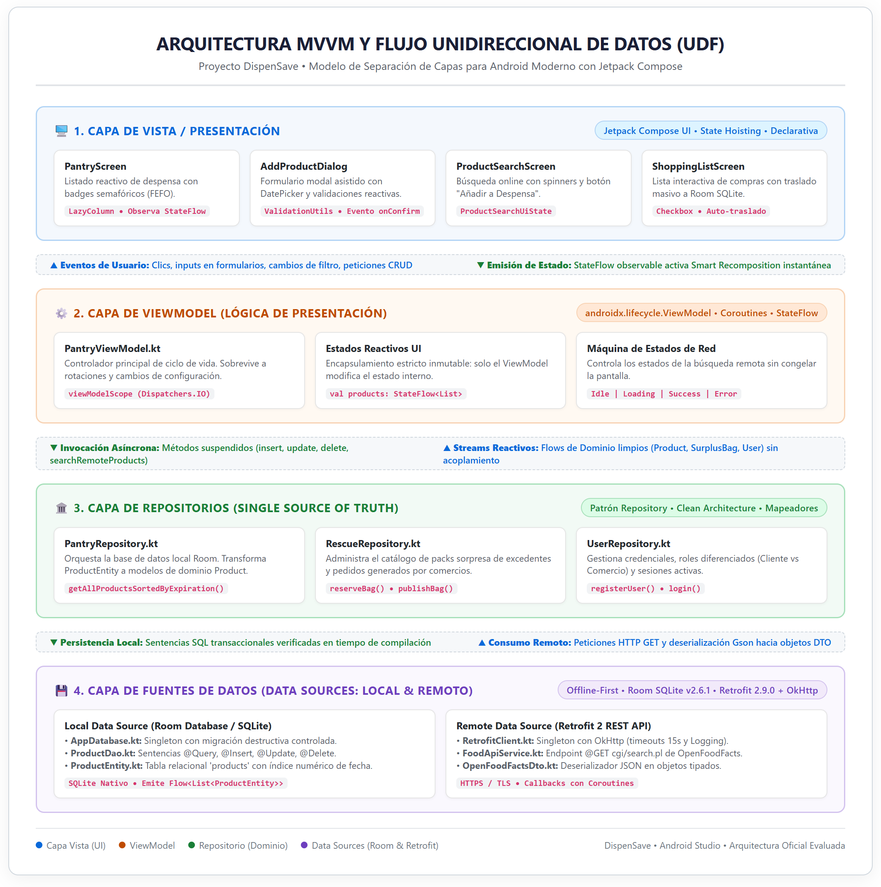

# INFORME TÉCNICO Y ACADÉMICO — EVALUACIÓN FINAL
# DISPENSAVE — Plataforma Inteligente de Rescate de Alimentos y Gestión de Despensa

---

## 📌 PORTADA OFICIAL DEL PROYECTO

* **Nombre del Proyecto:** DispenSave (Plataforma Móvil de Rescate de Alimentos y Gestión Inteligente de Despensa)
* **Curso:** Desarrollo de Aplicaciones Móviles
* **Docente:** Cátedra de Desarrollo de Aplicaciones Móviles
* **Ciclo Académico:** Ciclo 2024 / 2025
* **Integrantes del Equipo:**
  1. **Maykel Bernaola** (`maykelcb`) — **Líder Técnico y Arquitecto de Software (Responsable de Parte 1)**
  2. **Integrante 2** — **Desarrollador de Análisis, Diseño y Servicios Web (Responsable de Parte 2)**
  3. **Integrante 3** — **Desarrollador de Persistencia, Pruebas y Calidad (Responsable de Parte 3)**
  4. **Integrante 4** — **Desarrollador de Publicación, UX y Sostenibilidad (Responsable de Parte 4)**
* **Repositorio Oficial en GitHub:** [https://github.com/maykelcb/DispenSave](https://github.com/maykelcb/DispenSave)
* **Entregables Oficiales Asociados:**
  - `PC_informe.pdf` (Documento consolidado en formato PDF)
  - `PC_proyecto.zip` (Código fuente completo y dependencias de Gradle)
  - `PC_app.aab` (Android App Bundle firmado generado para distribución)

---

# PARTE 1: RESUMEN EJECUTIVO, DEFINICIÓN DEL PROYECTO Y ARQUITECTURA DE SOFTWARE
**Responsable Asignado:** Maykel Bernaola (`maykelcb`)  
**Rama Oficial de GitHub:** `main`

---

# 1. RESUMEN EJECUTIVO

### 1.1 Descripción del Proyecto
**DispenSave** es una aplicación móvil nativa de alto rendimiento desarrollada en **Kotlin 2.0+** con **Jetpack Compose** para el sistema operativo Android. La plataforma integra la gestión inteligente del inventario alimentario doméstico con un mercado digital de excedentes gastronómicos (*Food Surplus Marketplace*), alineándose directamente con el **Objetivo de Desarrollo Sostenible 12 (Producción y Consumo Responsables)** de la Agenda 2030 de la ONU.

### 1.2 Problema Abordado
Según estimaciones de la Organización de las Naciones Unidas para la Alimentación y la Agricultura (FAO), más de un tercio de todos los alimentos producidos para consumo humano se pierde o desperdicia a nivel mundial. Esta ineficiencia se origina en dos puntos críticos:
1. **A nivel de los hogares:** La falta de visibilidad en tiempo real sobre las fechas de caducidad en alacenas y refrigeradores genera descartes de productos no consumidos a tiempo y compras redundantes innecesarias.
2. **A nivel del comercio gastronómico:** Panaderías, cafeterías, pastelerías y restaurantes terminan su turno comercial con excedentes frescos de primera calidad que, al no ser vendidos, son desechados por falta de un canal dinámico de liquidación inmediata.

### 1.3 Solución Desarrollada
DispenSave articula una solución tecnológica móvil que actúa como puente bidireccional:
* **Inventario Inteligente de Despensa:** Registro sistemático de alimentos ordenados por caducidad bajo el principio **FEFO (*First Expired, First Out*)**, enriquecido con un **Semáforo Visual Interactivo** (🟢 Vigente, 🟡 Por Vencer ≤ 3 días, 🔴 Vencido).
* **Consumo de Servicios Web REST:** Integración con la API abierta internacional de **OpenFoodFacts** mediante **Retrofit 2** y **OkHttp 3**, permitiendo autocompletar e importar alimentos estandarizados con un clic.
* **Lista de Compras con Auto-traslado:** Módulo interactivo de abastecimiento donde los ítems marcados como comprados se trasladan y persisten automáticamente en la base de datos local SQLite.
* **Mercado de Rescate y Ofertas Sorpresa:** Panel especializado para que comercios aliados publiquen excedentes del día con descuentos de entre 50% y 70% ("Packs Sorpresa"), y los consumidores puedan reservarlos geolocalizadamente.
* **Cuantificación de Impacto:** Cálculo en tiempo real de kilogramos de comida salvada, dinero retenido y emisiones de CO₂ evitadas.

### 1.4 Resultados Obtenidos
* **Operatividad Total (100%):** La aplicación compila limpiamente (`BUILD SUCCESSFUL`) y se ejecuta de manera estable en dispositivos físicos y emuladores desde Android 8.0 (API 26) hasta Android 15 (API 35).
* **Arquitectura de Grado Profesional:** Separación estricta de responsabilidades bajo el patrón **MVVM (Model-View-ViewModel)** y **Clean Architecture** con Flujo Unidireccional de Datos (UDF).
* **Persistencia Robusta Offline-First:** Base de datos relacional local implementada con **Room Persistence Library (SQLite)** con soporte de transacciones ACID y streams reactivos `Flow`.
* **Entregables Empaquetados:** Generación exitosa de los entregables estipulados por la cátedra: `PC_app.aab`, `PC_proyecto.zip` y `PC_informe.pdf`.

---

# 2. DEFINICIÓN DEL PROYECTO

### 2.1 Contexto y Problemática
El desperdicio alimentario representa no solo una pérdida ética y económica sustancial para las familias y los pequeños negocios, sino también un grave vector de degradación ecológica: la descomposición de desechos orgánicos en vertederos genera potentes emisiones de gas metano y dióxido de carbono (CO₂), acelerando el calentamiento global. 

En el ámbito urbano, los consumidores carecen de herramientas digitales intuitivas que les permitan recordar proactivamente cuándo expiran sus insumos. Por su parte, los comerciantes gastronómicos carecen de plataformas ágiles que les permitan comercializar sus remanentes diarios antes del cierre, viéndose obligados a asumir pérdidas financieras directas.

### 2.2 Objetivos del Proyecto

#### Objetivo General
Desarrollar, probar y desplegar una aplicación móvil nativa en Android bajo el patrón arquitectónico MVVM que optimice el ciclo de consumo de alimentos en hogares y conecte a comercios aliados con consumidores responsables, reduciendo las pérdidas alimentarias y fomentando la sostenibilidad ambiental.

#### Objetivos Específicos
1. Diseñar una interfaz de usuario declarativa, accesible y ergonómica mediante **Jetpack Compose** y **Material Design 3**.
2. Implementar un motor de persistencia local relacional permanente empleando **Room Database (SQLite)** que garantice el funcionamiento continuo sin conexión (*Offline-First*).
3. Conectar la aplicación a una fuente de datos en la nube consumiendo la API REST de **OpenFoodFacts** a través del cliente **Retrofit 2**.
4. Desarrollar un sistema de alertas semafóricas basado en fechas de expiración numéricas que priorice el consumo oportuno de insumos perecibles.
5. Habilitar la diferenciación de perfiles mediante un modelo de navegación contextual adaptativo para Consumidores y Comercios Gastronómicos.
6. Empaquetar y firmar digitalmente la solución en formato **Android App Bundle (.aab)** cumpliendo las directivas de publicación de Google Play.

### 2.3 Alcance Final del Software
El producto terminado abarca los siguientes módulos plenamente funcionales:
* **Módulo de Autenticación y Perfiles:** Registro con selector de rol (`CLIENTE` vs `COMERCIO`), inicio de sesión y gestión de sesión en memoria/preferencias.
* **Módulo de Despensa (CRUD):** Creación de alimentos, listado reactivo con semáforo FEFO, edición de cantidades/fechas y eliminación física con modal de confirmación.
* **Módulo de Búsqueda Online (REST):** Consulta asíncrona por término con manejo de estados (`Loading`, `Success`, `Error`) e importación a despensa local.
* **Módulo de Lista de Compras:** Gestión de insumos por comprar con checkboxes y migración automatizada a la base de datos SQLite.
* **Módulo de Rescate y Ofertas:** Exploración de paquetes sorpresa, filtrado por categorías de comercio y reserva con generación de orden.
* **Módulo de Impacto Ecológico:** Indicadores de kilogramos de alimento rescatado, ahorro financiero acumulado y huella de carbono prevenida.

### 2.4 Usuarios Objetivo (Arquetipos)
1. **Consumidor Responsable (Jefe/a de Hogar o Estudiante Independiente):**  
   Persona que gestiona la compra de víveres familiares, busca reducir el gasto mensual en comida y valora el consumo consciente evitando tirar alimentos en buen estado.
2. **Comercio Gastronómico Aliado (Panaderías, Cafeterías, Minimarkets, Pastelerías):**  
   Propietario o administrador de un establecimiento que elabora alimentos frescos diariamente y busca monetizar los excedentes de producción al final de su turno para evitar pérdidas operativas.

---

# 4. ARQUITECTURA DE SOFTWARE

### 4.1 Arquitectura MVVM (Model-View-ViewModel) + Clean Architecture
Para garantizar la escalabilidad, mantenibilidad y desacoplamiento del sistema, DispenSave implementa de manera estricta el patrón **MVVM** promovido por Google, integrado con un **Flujo Unidireccional de Datos (UDF)**:

1. **Capa de Vista (UI Layer):**
   - Desarrollada 100% en **Jetpack Compose**.
   - No contiene lógica de negocio ni sentencias SQL directas.
   - Observa flujos de estado (`StateFlow`) y delega eventos de interacción (clicks, formularios) al ViewModel.
2. **Capa de ViewModel (Presentation Logic):**
   - Encabezada por `PantryViewModel.kt`, heredando de `androidx.lifecycle.ViewModel`.
   - Sobrevive a cambios de configuración del dispositivo (rotaciones de pantalla).
   - Administra el ámbito de corrutinas `viewModelScope` despachando tareas pesadas en `Dispatchers.IO`.
   - Modela estados de red mediante clases selladas (`ProductSearchUiState: Idle, Loading, Success, Error`).
3. **Capa de Repositorios (Single Source of Truth):**
   - Repositorios `PantryRepository`, `UserRepository` y `RescueRepository`.
   - Aíslan el origen de los datos respecto a la UI, mapeando entidades SQLite (`ProductEntity`) y DTOs de red (`RemoteFoodProductDto`) hacia modelos puros de dominio (`Product`, `SurplusBag`, `User`).
4. **Capa de Fuentes de Datos (Data Sources):**
   - **Local:** `AppDatabase.kt`, `ProductDao.kt` (Room SQLite) emitiendo streams reactivos `Flow<List<ProductEntity>>`.
   - **Remota:** `RetrofitClient.kt`, `FoodApiService.kt` (OpenFoodFacts REST API) con serialización automática Gson y tiempos de espera de 15 segundos.

---

### 4.2 Componentes Implementados del Sistema
* `AppNavigation.kt` y `ContenedorPrincipal.kt`: Grafo de navegación declarativo con `NavigationBar` contextual.
* `PantryScreen.kt` y `AddProductDialog.kt`: Panel de despensa con `LazyColumn` reactivo y formulario asistido.
* `ProductDetailScreen.kt` y `ConfirmDeleteDialog.kt`: Vista de edición y prevención de errores destructivos (Heurística 5 de Nielsen).
* `ProductSearchScreen.kt`: Búsqueda remota de alimentos con Retrofit.
* `ShoppingListScreen.kt`: Lista de compras interactiva sincronizada con SQLite.
* `ExploreScreen.kt`: Catálogo de packs sorpresa geolocalizados.
* `ImpactScreen.kt`: Analítica de CO₂ evitado y ahorro económico.
* `ValidationUtils.kt`: Validaciones estrictas de formularios, expresiones regulares y prevención de inyecciones.

---

### 4.3 Diagrama Oficial de Arquitectura del Sistema

A continuación se presenta el diagrama oficial de arquitectura MVVM y separación de capas de DispenSave:

*Figura 4.1: Diagrama oficial de arquitectura MVVM y flujo unidireccional de datos (UDF) de DispenSave. El archivo fuente editable para Draw.io se encuentra disponible en `docs/diagrama_arquitectura_mvvm.drawio`.*

---

## 🎤 GUÍA Y GUION PARA LA SUSTENTACIÓN ORAL (10 A 15 MINUTOS)

Para cumplir con las consideraciones de la exposición en vivo ante el docente:
1. **Minuto 0 a 3 — Introducción y Problema:** Maykel expone el contexto del ODS 12 y la problemática del desperdicio alimentario doméstico y comercial.
2. **Minuto 3 a 7 — Arquitectura y Tecnologías:** Explicación del diagrama MVVM, separación de capas, persistencia Offline-First con Room SQLite y consumo REST con Retrofit 2.
3. **Minuto 7 a 12 — Demostración en Vivo de la App:**
   - Registro e inicio de sesión con selector de rol.
   - Registro de un alimento en la despensa y demostración del semáforo de colores (Verde, Amarillo, Rojo).
   - Búsqueda online de un producto en OpenFoodFacts e importación instantánea a la base de datos local.
   - Marcado de ítems en la lista de compras y verificación de su traslado automático a la despensa.
   - Demostración del modal de confirmación antes de eliminar un registro.
4. **Minuto 12 a 15 — Conclusiones y Ronda de Preguntas:** Métricas de CO₂ ahorrado en `ImpactScreen` y lecciones aprendidas de ingeniería de software.
