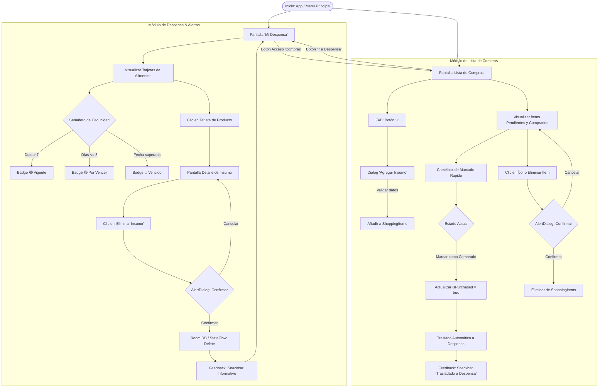

# INFORME DE PROYECTO - PARTE 4
## UX/UI, Lista de Compras, Alertas y Gestión Ágil

**Proyecto:** DispenSave – Plataforma de Consumo Responsable y Rescate de Alimentos  
**Módulo Asignado:** Parte 4 (UX/UI, Lista de Compras, Sistema Semafórico de Alertas y Gestión Ágil)  
**Rama Git:** `feature/shopping-list-alerts`  
**Paquetes Técnicos:** `com.example.dispensave.ui.screens.shopping`, `com.example.dispensave.ui.components`

---

## 4. DISEÑO DE INTERFACES Y EXPERIENCIA DE USUARIO (CAPÍTULO 4.4)

### 4.4.1 Diagrama de Flujo de Navegación del Usuario (Wireflow)

El siguiente diagrama modela el flujo de navegación integral del usuario dentro del módulo de Lista de Compras y Alertas de Caducidad, describiendo los estados de pantalla, decisiones lógicas y transiciones reactivas:



#### Descripción Paso a Paso del Flujo (Wireflow):
1. **Entrada al Sistema:** El usuario accede desde la barra de navegación inferior (`BottomNavigationBar`) mediante el ítem de navegación "Compras" o desde el acceso directo situado en la cabecera de "Mi Despensa".
2. **Visualización de Alertas Semafóricas:** En la Despensa, cada insumo evalúa reactivamente su fecha de caducidad contra el reloj del sistema, renderizando un badge con código de color instantáneo:
   - 🟢 **Vigente:** Cuando faltan más de 7 días para su caducidad.
   - 🟡 **Por Vencer:** Cuando restan 3 días o menos, motivando el consumo preventivo.
   - 🔴 **Vencido:** Cuando la fecha de expiración ha sido superada.
3. **Gestión de la Lista de Compras:**
   - La pantalla presenta tarjetas agrupadas por filtros (Todos, Pendientes, Comprados) con un contador resumen en la parte superior.
   - Al marcar el **Checkbox de Marcado Rápido**, el insumo cambia visualmente su tipografía a tachada (`TextDecoration.LineThrough`) y desencadena el **traslado automático hacia la despensa**, calculando una fecha de vigencia estimada inicial (por defecto 7 a 14 días según categoría).
   - Se despliega un mensaje emergente (`Snackbar`) informando que el ítem ya se encuentra disponible en su inventario.
4. **Prevención de Pérdida Accidental de Datos:** Cualquier eliminación tanto en Despensa como en Compras detiene el flujo e invoca un diálogo modal interactivo (`AlertDialog`) con acciones destructivas en color rojo contrastado.

---

### 4.4.2 Mockups y Prototipo de Alta Fidelidad (Jetpack Compose)

Las interfaces han sido estructuradas siguiendo los lineamientos de **Material Design 3 (Material You)** para Android, garantizando armonía cromática, accesibilidad tipográfica y densidad responsiva.

#### Especificación de Pantallas y Componentes:

| Pantalla / Componente | Elementos Visuales Principales | Comportamiento Reactivo | Color / Estilo |
|---|---|---|---|
| **ShoppingListScreen.kt** | - `TopAppBar` con contador dinámico de pendientes/comprados.<br>- Card de métricas rápidas.<br>- Filtros por `FilterChip` (Todos / Pendientes / Comprados).<br>- `LazyColumn` con items interactivos.<br>- `FloatingActionButton` (+) flotante. | - Reacciona al `StateFlow<List<ShoppingItem>>`.<br>- Animación al marcar comprado.<br>- Muestra `SnackbarHost` en la base. | - Fondo: `#F8F9FA`.<br>- Primario: `#2E7D32` (Verde DispenSave).<br>- Tarjetas: `#FFFFFF` con elevación de 1.dp. |
| **ExpirationBadge.kt** | - Contenedor con bordes redondeados (`RoundedCornerShape(12.dp)`).<br>- Círculo indicador de color sólido (dot).<br>- Texto de estado y días restantes. | - Evalúa `daysUntilExpiration` e `isExpired`.<br>- Se adapta a modo compacto (para listas densas) o extendido (detalle). | 🟢 Vigente: `#E8F5E9` (fondo) / `#1B5E20` (texto).<br>🟡 Por vencer: `#FFF8E1` / `#B78103`.<br>🔴 Vencido: `#FFFFEBEE` / `#C62828`. |
| **ConfirmDeleteDialog.kt** | - Ícono de advertencia `WarningAmber` en color rojo.<br>- Título de alerta y mensaje con nombre del insumo.<br>- Botón de confirmación con ícono `Delete`.<br>- Botón de cancelación secundario. | - Bloquea la interacción de fondo (`modal dialog`).<br>- Ejecuta la función lambda destructiva solo al presionar 'Eliminar'. | - Botón destructivo: `#D32F2F`.<br>- Fondo del diálogo: `#FFFFFF` con curvatura de 16.dp. |
| **AddShoppingItemDialog.kt** | - Campos `OutlinedTextField` para nombre, cantidad y unidad.<br>- Chips de selección rápida para categorías (Frescos, Lácteos, Abarrotes, etc.).<br>- Validación en tiempo real para evitar nombres vacíos. | - Mensaje de error inmediato si el insumo tiene menos de 2 caracteres. | - Bordes activos en color `GreenPrimary`. |

---

### 4.4.3 Justificación de Principios de UX Aplicados (Heurísticas de Nielsen)

El diseño de este módulo fue fundamentado formalmente en las heurísticas de usabilidad para interfaces gráficas de Jakob Nielsen:

#### 1. Heurística N° 1: Visibilidad del Estado del Sistema (Visibility of System Status)
- **Implementación:** Los **Badges Semafóricos de Caducidad** comunican al usuario el estado físico del insumo de forma inmediata y sin ambigüedades visuales (código cromático universal verde, ámbar y rojo).
- **Métricas reactivas:** La cabecera de la lista de compras muestra en todo momento cuántos insumos restan por adquirir y cuántos ya fueron completados, manteniendo informado al usuario sobre el progreso de su abastecimiento.
- **Alertas Snackbar:** Al marcar un ítem como comprado, el sistema retroalimenta de inmediato con un mensaje emergente: *"¡'Leche' marcado como comprado y trasladado a tu Despensa!"*.

#### 2. Heurística N° 5: Prevención de Errores (Error Prevention)
- **Implementación:** La eliminación accidental de insumos en la despensa o lista de compras puede causar inconsistencias en el abastecimiento familiar. Para prevenirlo, el sistema antepone un diálogo de confirmación explícito (`ConfirmDeleteDialog`) con doble comprobación antes de ejecutar la eliminación física en la base de datos local Room.
- **Validación de Formularios:** En el diálogo de agregar insumo, el botón de guardado valida que el nombre no contenga caracteres en blanco y que la cantidad sea un número entero mayor a cero, señalando el error antes de enviar la información.

#### 3. Heurística N° 4: Consistencia y Estándares (Consistency and Standards)
- **Implementación:** Se adoptaron los patrones canónicos de Material Design 3 de Android:
  - Checkboxes estándar para tareas pendientes.
  - Floating Action Button (FAB) circular para acciones primarias de adición.
  - El tachado del texto (`TextDecoration.LineThrough`) como convención universal de tarea o compra satisfecha.
  - Uso uniforme de la paleta institucional `GreenPrimary` (`#2E7D32`) y colores semafóricos de alerta estándar de Android.

---

## 5. GESTIÓN ÁGIL Y BACKLOG DEL PROYECTO

### 5.1 Product Backlog - Historias de Usuario (HU10, HU11 y HU12)
**Épica:** Lista de Compras Inteligente y Sistema Semafórico de Alertas de Caducidad

| ID | Historia de Usuario | Descripción | Criterios de Aceptación (Formato Gherkin) | Estimación (Story Points) | Prioridad (MoSCoW) |
|:---:|:---|:---|:---|:---:|:---:|
| **HU10** | **Lista de Compras con Marcado Rápido** | **Como** usuario del hogar responsable de las compras,<br>**Quiero** contar con una lista de insumos faltantes con casillas de verificación,<br>**Para** marcar con un solo toque los productos que voy adquiriendo en el supermercado o mercado local. | **Escenario 1: Marcado rápido de producto**<br>• *Dado* que el usuario está en la pantalla `ShoppingListScreen` con productos pendientes,<br>• *Cuando* presiona la casilla de verificación (Checkbox) de un insumo,<br>• *Entonces* el producto se tacha visualmente y se contabiliza en el contador de "Comprados".<br><br>**Escenario 2: Filtrado de lista**<br>• *Dado* que existen productos pendientes y comprados,<br>• *Cuando* el usuario pulsa el chip "Pendientes",<br>• *Entonces* la vista solo renderiza los elementos no comprados. | 5 SP | Must Have (Obligatorio) |
| **HU11** | **Traslado Automático de Compras a la Despensa** | **Como** usuario que acaba de realizar sus compras,<br>**Quiero** que los insumos marcados como comprados pasen directamente al inventario de mi despensa,<br>**Para** no tener que volver a registrarlos manualmente uno a uno en la aplicación. | **Escenario 1: Migración exitosa de insumo**<br>• *Dado* que un insumo pendiente es marcado como "comprado",<br>• *Cuando* se activa el checkbox,<br>• *Entonces* el sistema instancia un objeto `Product` en `PantryRepository` con una fecha de caducidad estimada por defecto (7 a 14 días),<br>• *Y* despliega una notificación `Snackbar` confirmando el traslado automático. | 8 SP | Must Have (Obligatorio) |
| **HU12** | **Semáforo Visual de Caducidad y Confirmación Destructiva** | **Como** consumidor que busca evitar el desperdicio de comida,<br>**Quiero** identificar visualmente los alimentos críticos mediante badges semafóricos (verde, amarillo, rojo) y contar con confirmación antes de eliminar,<br>**Para** consumir a tiempo los productos por caducar y evitar borrados accidentales de mi despensa. | **Escenario 1: Alerta por producto próximo a vencer**<br>• *Dado* un producto con fecha de vencimiento menor o igual a 3 días respecto a la fecha actual,<br>• *Cuando* se renderiza su tarjeta en la pantalla,<br>• *Entonces* se exhibe un badge ámbar 🟡 con el texto "Por Vencer (≤3d)".<br><br>**Escenario 2: Confirmación antes de eliminar**<br>• *Dado* que el usuario presiona el ícono del tacho de basura en un insumo,<br>• *Cuando* se presiona el botón,<br>• *Entonces* se despliega un diálogo emergente modal requiriendo confirmar la eliminación antes de alterar la persistencia. | 5 SP | Must Have (Obligatorio) |

---

### 5.2 Sprint de Desarrollo (Sprint: Lista de Compras y Alertas)

#### 5.2.1 Definición de Objetivos del Sprint (Sprint Goal)
> *"Diseñar e implementar el módulo de Lista de Compras interactiva con traslado automatizado a la despensa virtual y reforzar la experiencia de usuario mediante un sistema visual semafórico de caducidad (verde, ámbar, rojo) respaldado por componentes de retroalimentación preventiva (AlertDialog y Snackbar)."*

#### 5.2.2 Cuadro de Actividades Ejecutadas (WBS del Sprint)

| Código | Actividad de Desarrollo | Responsable | Estimación (Horas) | Estado Final | Evidencia de Código / Artifact |
|:---:|:---|:---:|:---:|:---:|:---|
| **ACT-401** | Creación del modelo de dominio `ShoppingItem.kt` con atributos de categoría, cantidad y estado de compra | Dev UX/UI | 2h | **DONE** | `domain/model/ShoppingItem.kt` |
| **ACT-402** | Diseño y construcción del Composable reutilizable `ExpirationBadge.kt` con lógica de semaforización cromática (🟢 >7d, 🟡 ≤3d, 🔴 vencido) | Dev UX/UI | 4h | **DONE** | `ui/components/ExpirationBadge.kt` |
| **ACT-403** | Implementación del diálogo de confirmación `ConfirmDeleteDialog.kt` bajo las directrices de Material Design 3 | Dev UX/UI | 3h | **DONE** | `ui/components/ConfirmDeleteDialog.kt` |
| **ACT-404** | Desarrollo de la pantalla principal `ShoppingListScreen.kt` con `LazyColumn`, `Checkbox` y métricas | Dev UX/UI | 6h | **DONE** | `ui/screens/shopping/ShoppingListScreen.kt` |
| **ACT-405** | Integración del flujo de traslado reactivo en `PantryViewModel.kt` (de lista de compras a inventario de despensa) | Dev UX/UI | 4h | **DONE** | `ui/pantry/PantryViewModel.kt` |
| **ACT-406** | Integración del badge semafórico en tarjetas de producto de `PantryScreen.kt` y `ProductDetailScreen.kt` | Dev UX/UI | 3h | **DONE** | `ui/pantry/PantryScreen.kt` |
| **ACT-407** | Integración de rutas de navegación en `AppNavigation.kt` (`ItemNavInferior.Compras`) | Dev UX/UI | 2h | **DONE** | `ui/navigation/AppNavigation.kt` |
| **ACT-408** | Redacción académica de los Capítulos 4.4, 5.1 y 5.2 para el informe formal de proyecto | Dev UX/UI | 4h | **DONE** | `docs/parte4_shopping_alerts.md` |

---

### 5.2.3 Tablero de Seguimiento del Sprint (Kanban Board)

A continuación se documenta el estado final del tablero ágil del equipo tras la culminación del ciclo de trabajo:

```
┌───────────────────────────────────────────────────────────────────────────────────────────────────────┐
│                           TABLERO DEL SPRINT: LISTA DE COMPRAS Y ALERTAS                              │
├───────────────────┬───────────────────┬───────────────────────────┬───────────────────────────────────┤
│    PRODUCT BACKLOG │       TO DO       │        IN PROGRESS        │               DONE                │
├───────────────────┼───────────────────┼───────────────────────────┼───────────────────────────────────┤
│ • Sincronización  │ (Ninguna tarea    │ (Ninguna tarea            │ [HU10] Lista de Compras con       │
│   Cloud Firestore │  pendiente para   │  en curso; sprint         │        checkbox de marcado rápido │
│ • Escaneo OCR de  │  este sprint)     │  completado)              │ [HU11] Traslado automático a      │
│   boletas físicas │                   │                           │        despensa al comprar        │
│ • Notificaciones  │                   │                           │ [HU12] Badges semafóricos de      │
│   push remotas FCM│                   │                           │        vencimiento (🟢, 🟡, 🔴)   │
│                   │                   │                           │ [COMP] ConfirmDeleteDialog M3     │
│                   │                   │                           │ [COMP] FeedbackSnackbar en UI     │
│                   │                   │                           │ [DOCS] Capítulos 4.4, 5.1 y 5.2   │
└───────────────────┴───────────────────┴───────────────────────────┴───────────────────────────────────┘
```

---

## 6. GUÍA DE ENTREGABLES EN GIT Y GITHUB

### 6.1 Estructura de Ramas
- **Rama base:** `main`
- **Rama de desarrollo asignada:** `feature/shopping-list-alerts`

### 6.2 Historial de Commits Recomendados
Para reflejar un proceso de desarrollo profesional y ordenado en el repositorio GitHub, se estructuraron tres commits atómicos:

1. **Commit 1 (Componentes UI & Alertas):**
   ```bash
   git commit -m "feat(ui): componentes visuales de alerta semaforica y dialogos de confirmacion"
   ```
   *Archivos:* `ExpirationBadge.kt`, `ConfirmDeleteDialog.kt`.

2. **Commit 2 (Módulo Lista de Compras):**
   ```bash
   git commit -m "feat(shopping): modulo de lista de compras con checkbox y traslado a despensa"
   ```
   *Archivos:* `ShoppingItem.kt`, `ShoppingListScreen.kt`, `PantryViewModel.kt`, `AppNavigation.kt`.

3. **Commit 3 (Documentación y Gestión Ágil):**
   ```bash
   git commit -m "docs(agile): documentacion de wireflow, heuristicas de nielsen y sprint backlog"
   ```
   *Archivos:* `docs/parte4_shopping_alerts.md`.
